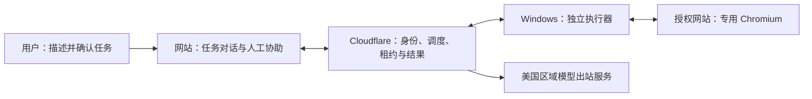

# TaskRelay · 任务接力

**交代一次，按时执行。**

[](https://github.com/zhangheng2022/taskrelay/actions/workflows/ci.yml)
[更新记录](CHANGELOG.md) · [验收范围](docs/ACCEPTANCE.md) · [部署说明](docs/DEPLOYMENT.md) · [问题反馈](https://github.com/zhangheng2022/taskrelay/issues)

浏览器任务工作台：用户在网站管理各自的任务，Cloudflare 统一调度，管理员授权的 Windows 执行器在专用 Chromium 中执行。所有验证码、扫码和操作确认都通过网站任务对话处理。

## 当前状态

- **开发验收阶段**：客户端源码及本机系统安装为 **0.4.8**，已完成本轮安装 smoke 和业务闭环复验；快捷方式重开、自动升级与独立机器验收仍待补齐。尚未发布 GitHub Release。版本记录不代表已有稳定安装包；发布后可从 [Releases](https://github.com/zhangheng2022/taskrelay/releases) 获取。
- 工作空间：[tr.zhangheng.eu.org](https://tr.zhangheng.eu.org)，公开注册当前关闭。原 `taskrelay.zhangheng.workers.dev` 地址继续兼容已配对客户端。
- Windows 是独立执行器；任务编辑、聊天、历史与模型设置在网站完成。0.4.7 起支持版本检查、新版提醒、确认下载与空闲自动安装；更新网络经过 Cloudflare，客户端不直连 GitHub。旧版首次启用需安装新包，发布通道状态见验收台账。
- 已有源码测试、开发机打包，以及真实模型在虚构站上的协助、批准/拒绝、提交后进程中断与只读核查证据。干净 Windows、更多模型提供方、断网/休眠等其他故障和连续观察仍需补齐，以 [验收台账](docs/ACCEPTANCE.md) 为准。
- Cloudflare 按 Free 约束运行，预算耗尽后拒绝新工作；**模型服务费用由提供方单独计算**。

## 可以做什么

| 能力 | 行为与边界 |
| --- | --- |
| 自然语言创建 | 多轮补全网站、目标和成功判据；确认任务卡后才保存或试运行 |
| 手动与定时执行 | 调度、版本、领取和租约由云端管理；离线不新增本地调度 |
| 浏览器操作 | 在授权站点内读取、导航、填写和提交，仅执行任务卡允许的动作 |
| 人工协助 | 回复绑定运行、步骤和租约；敏感回复不进入普通聊天历史 |
| 结果与报告 | 展示实际步骤、程序核验与所选运行的报告；未知结果先只读核查，不自动重提 |
| 模型兼容 | Chat Completions / Responses，自由填写模型名；必须通过所需能力测试，不静默换模型 |
| 用户与设备 | 用户工作空间隔离，管理员维护共享模型与可信 Windows 设备池 |

文字成功判据目前要求一段连续页面原文，不把多个独立条件拼接。共享设备须由可信管理员维护，浏览器 Profile 隔离不对设备管理员隐藏数据。TaskRelay 不提供任意 JavaScript、Shell、主机文件操作或远程浏览器接管工具。



## 使用

1. 管理员在网站“设置 → 模型服务”配置公网 OpenAI 兼容服务和任意模型名称；普通用户使用管理员提供的模型。默认 Chat Completions，也支持 Responses。Base URL 示例 `https://api.openai.com/v1`；粘贴完整 `/responses` 或 `/chat/completions` 地址时自动规范，并检查协议是否一致。
2. 保存后执行“测试能力”。连接、工具调用、结构化输出都通过后才能创建 AI 任务。图像能力可以单独测试。未返回用量或未设置单价时显示未知。
3. 管理员安装 Windows x64 的 `TaskRelay Setup.exe`，在执行器配对入口通过系统浏览器授权，核对网站和客户端的校验码。
4. 点击“新建任务”，用一句话描述目标和完整网站地址；信息不足时继续对话补充。检查确认卡中的网站、账号、时间、操作授权和成功判据，再点击“创建并试运行”。核验成功才启用周期调度。
5. 需要协助时在任务对话回复。敏感信息不会进入普通聊天历史。结果待核查时先运行只读核查，不自动重复提交。

客户端关闭窗口后保留托盘；从托盘选择退出会停止本机进程。自启动默认关闭。离线时可读缓存、停止本机执行，不能创建或调度新任务。

网站采用 shadcn/ui 默认中性色主题，支持浅色、深色和跟随系统。左侧选择任务，中间查看对话、折叠步骤和结果，底部回复；通过“调整任务”生成修改草稿，确认后保存并重新试运行。Windows 使用独立执行器界面，仅提供连接、状态、暂停、停止、自启动和诊断。

所有模型请求统一由美国区域的 Cloudflare Durable Object 后台发出，覆盖能力测试、任务解析、执行规划和人工协助解析。网站及桌面均不直连模型服务，也不向模型服务传递访问者的地区/IP 请求上下文。现有 `gpt-6-luna / Responses` 已通过真实连接、工具及严格结构化输出测试；这不等同于真实网站任务闭环验收。

## 开发

开发机需要 Node.js 24+；最终用户无需 Node.js。

```powershell
npm ci
node scripts/setup-local.mjs
npm run db:migrate
npm run dev
```

网站本地地址 `http://127.0.0.1:5173`。仅本机 DEV_MODE 允许开发身份绕过；生产固定关闭。不要将开发服务器暴露到网络。

`setup-local` 仅在缺失时写入本地密钥，不覆盖现有 `MASTER_KEY`；`db:migrate` 只迁移本地 D1。不要提交 `.dev.vars`、凭据或数据库。首次运行桌面前准备浏览器，再另开终端启动：

```powershell
npm run prepare:browser
npm run desktop
```

本地 workerd 不实现地区约束，真实模型调用会明确返回 `MODEL_REGION_REQUIRES_DEPLOYMENT`。真实模型联调请使用已部署的 Cloudflare 环境；本地协议/状态测试使用隔离模拟，不静默回退到本地网络发送密钥。

```powershell
npm run typecheck
npm test
npm run build
npm run check:repo
```

可选 `node scripts/seed-ui.mjs` 向本地 D1 写入明确标记为“演示”的界面检查数据，不连接生产环境。

界面验收也可打开 `/ui-fixture.html`：只在开发模式渲染共享 App，使用演示 Transport，不访问生产服务。可用 `?state=challenge`、`?state=failed`、`?state=offline`、`?desktop=1`、`?fail=1` 检查协助、未知结果、离线、桌面和首次请求失败。详情见 [UI-REVIEW.md](docs/UI-REVIEW.md)。

执行器界面使用 `?executor`；可加 `&update=available`、`downloading`、`waiting`、`installing` 或 `error` 检查更新状态，`&state=running` 模拟当前有任务。夹具不会实际下载或安装。发布更新请遵循[自动更新通道](docs/DEPLOYMENT.md#自动更新通道047-起)。

### GitHub 自动检查

[CI 工作流](.github/workflows/ci.yml) 在 PR、`master` 推送及手动触发时，分别在 Ubuntu 和 Windows 上使用 Node.js 24，执行 `npm ci`、类型检查、完整测试、Web 构建与仓库检查。Actions 固定到提交 SHA，仓库令牌只有读取权限，不携带生产密钥，不部署或发布 Release。

`npm test` 已包含 UI 测试；只检查界面时可运行 `npm run test:ui`。`npm run build` 仅构建 Web。CI 的隔离测试不等于真实模型、Windows 安装或完整调度恢复验收。

## Windows 构建

需要 Windows x64 构建环境。

品牌图形的矢量源文件为 `resources/brand-mark.svg`，共享 UI 使用同一图形并随主题着色。修改后运行 `npm run icons`，生成网站 favicon、Apple Touch Icon 和 Windows PNG/多尺寸 ICO；生成资源随源码保存，普通构建不需要重新生成。桌面窗口、托盘、EXE 和安装器沿用 `resources/icon.png` / `resources/icon.ico` 路径。

```powershell
npm run prepare:browser
npm run make
npm run test:smoke
```

`prepare:browser` 从官方 Chrome for Testing 下载 Windows x64 浏览器，固定到生成的版本/哈希清单。资源在 ASAR 外；构建验证浏览器文件哈希。Stagehand 固定 4.3.0，执行器保留原生 `import()` 并单独暂存生产依赖。

先完成最终 `make`，再生成该产物的新 smoke 报告；重新打包后旧报告不能复用。只需要解包程序时可用 `npm run package`。启动时将扩展原始字节写入应用自身的内容寻址运行目录，核对完整文件集合与 SHA-256 后加载，避免安装目录中的内容脚本被 Chromium 加载为空；缓存篡改会拒绝启动，不关闭校验。

- 安装包：`apps/desktop/out/make/squirrel.windows/x64/TaskRelay Setup.exe`
- 解包程序：`apps/desktop/out/TaskRelay-win32-x64/TaskRelay.exe`
- 安装产物测试：`out/packaged-smoke.json`
- 安装目录测试：`out/installed-smoke.json`
- 安装包 SHA-256 与测试结果：`out/release-manifest.json`
- 本机状态：Electron 的 `app.getPath('userData')`，通常 `%APPDATA%/TaskRelay`。SQLite 为 WAL/FULL，设备令牌使用 Windows 系统加密，账号 Profile 分离。

从 Windows 系统入口安装，并从实际桌面或开始菜单快捷方式启动，核对版本、进程路径和 ASAR 哈希，再对实际安装的版本运行：

```powershell
node scripts/smoke.mjs "$env:LOCALAPPDATA\TaskRelay\app-0.4.8\TaskRelay.exe" out/installed-smoke.json
node scripts/release-manifest.mjs
```

版本目录须与本次安装一致。Codex MSIX 可能将 AppData 重定向到独立 `LocalCache`；宿主内测试只证明报告中的副本，不能代替系统快捷方式验证，详见 [Windows 更新交付](docs/DEPLOYMENT.md#windows-更新交付)。本地清单含绝对路径，不应直接作为公开附件。

`test:smoke` 在打包后的 Electron utilityProcess 中加载实际 Stagehand/Chromium，使用独立自建站与确定性模型回调检查读取、提取、监测、错误验证码、前导零、登录签到和表单提交。它走独立 smoke 流程，不调用 `runtime.execute()` 或 `ExecutorHost`；不能替代完整任务恢复、真实模型或真实网站验收。

## 工程结构

| 路径               | 职责                                                           |
| ------------------ | -------------------------------------------------------------- |
| apps/web           | Vite 网站和 Cloudflare 部署配置                                |
| apps/cloud         | DO 内的 Hono API、D1 调度/租约/幂等、加密短期证据、美国区域模型网关 |
| apps/desktop       | Electron Main、受限 Preload、独立 utilityProcess 执行器、Forge |
| packages/contracts | Zod 协议、授权策略、时区调度                                   |
| packages/model     | Chat Completions / Responses 适配                              |
| packages/ui        | 自行设计的 React + shadcn/ui 共享界面                          |

架构现状与改进候选见 [ARCHITECTURE.md](docs/ARCHITECTURE.md)，开发及技能指引见 [AGENTS.md](AGENTS.md)。部署说明见 [DEPLOYMENT.md](docs/DEPLOYMENT.md)，实际验证范围见 [ACCEPTANCE.md](docs/ACCEPTANCE.md)。

报告问题时请附版本、系统、脱敏错误和复现步骤，不上传设备令牌、模型密钥、密码、验证码、浏览器 Profile 或数据库。项目尚未选择开源许可证；第三方组件说明见 [NOTICE](resources/NOTICE.txt)，公开源码不代表已授予任意再分发许可。


### LangChain 与 Cloudflare 免费运行架构

普通 Worker 只处理静态资源和轻量路由，Hono 业务进入 SQLite Durable Objects；对话通过 D1 outbox 异步执行，网站与客户端使用休眠 WebSocket 通知和低频兜底。短期图片在 DO 加密保存，生产已移除 R2 绑定。模型 API 保持现有配置与美国 alarm 出站链路，模型提供方费用不属于 Cloudflare 免费承诺。免费预算耗尽时停止接收新工作，不自动开通付费服务；详见 [免费部署](docs/DEPLOYMENT.md#cloudflare-free-运行架构)。

`node scripts/test-free-runtime.mjs` 验证隔离 workerd 的真实 DO 路由、异步 alarm、加密分块证据及 WebSocket 撤销；不调用真实模型。

本机 CPU 对照采样：`node scripts/profile-worker.mjs .cache/ai-profile/current`。脚本在本机 workerd 使用隔离 D1、合成账号和模型响应，输出 CPU profile 与统计；不读取生产密钥，不验证真实模型地区。统计含本地 D1 绑定开销，不能等同 Cloudflare 计费 CPU 或免费套餐达标证明。保留某次构建后可加 `--reuse-bundle` 重跑同一版本。

云端已接入 LangChain.js、LangGraph 与 D1 持久化。创建对话和任务聊天支持云端恢复、游标历史和滚动摘要；设置中的“我的记忆”管理明确确认的偏好。任务卡确认版本、设备租约和美国模型出站约束保持有效。

本地迁移使用 `npm run db:migrate`；现有生产已完成 [0.3.0 一次性切换](docs/DEPLOYMENT.md#langchain-030-一次性切换)，不得重复清理。免费架构新增 `0007_free_runtime.sql`，保留协议 3 和 SQLite schema 3。源码、安装包与生产验证范围分别记录在 [验收](docs/ACCEPTANCE.md)。
