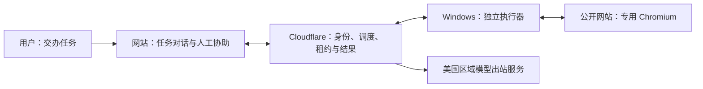

# TaskRelay · 任务接力

**交代任务，在同一聊天跟进结果。**

云端 LangGraph 理解意图并生成可调整的大步骤，桌面官方 createAgent 负责具体执行；LangChain 统一模型与工具消息，用户原话和补充直接交给执行器 AI 与 Stagehand，同一聊天展示过程、截图、协助及最终回复。不要求输入字段分类、自定义动作计划或独立成功审核。新交办目前按手动任务执行，运行条件卡与定时暂不扩展。源码版本、部署、安装和真实验收范围见验收记录。

[](https://github.com/zhangheng2022/taskrelay/actions/workflows/ci.yml)
[更新记录](CHANGELOG.md) · [验收范围](docs/ACCEPTANCE.md) · [部署说明](docs/DEPLOYMENT.md) · [问题反馈](https://github.com/zhangheng2022/taskrelay/issues)

浏览器任务工作台：用户在网站管理各自的任务，Cloudflare 统一调度，管理员授权的 Windows 执行器在专用 Chromium 中执行。所有验证码、扫码和操作确认都通过网站任务对话处理。

## 当前状态

- **开发预览阶段**：公开更新目录、源码版本与本机安装分别核验，当前版本与验证范围见部署和验收记录。未签名，非稳定版。
- 工作空间：[tr.zhangheng.eu.org](https://tr.zhangheng.eu.org)，公开注册当前关闭。原 `taskrelay.zhangheng.workers.dev` 地址继续兼容已配对客户端。
- Windows 是独立执行器；任务编辑、聊天、历史与模型设置在网站完成。0.4.7 起支持版本检查、新版提醒、确认下载与空闲自动安装；更新网络经过 Cloudflare，客户端不直连 GitHub。旧版首次启用需安装新包，发布通道状态见验收台账。
- 已有源码测试、开发机打包，以及真实模型在虚构站上的协助、批准/拒绝、提交后进程中断与只读核查证据。干净 Windows、更多模型提供方、断网/休眠等其他故障和连续观察仍需补齐，以 [验收台账](docs/ACCEPTANCE.md) 为准。
- Cloudflare 保持 Free，不设置项目级每日平台预算或个人次数门槛；**模型服务费用由提供方单独计算**。

## 可以做什么

| 能力         | 行为与边界                                                                       |
| ------------ | -------------------------------------------------------------------------------- |
| 自然语言交办 | 明确交办直接执行；缺少必要信息才追问；当前按手动交办执行                         |
| 执行与调度   | 云端管理版本、领取与租约；新条件卡/定时配置暂不开放，旧确认条件兼容保留          |
| 浏览器操作   | AI 根据目标选择相关公开网站并读取、导航、填写和提交；保留公网访问与凭据保护      |
| 人工协助     | 执行器先求助云端，必要时询问用户；协助加密保存，本人聊天可查看                   |
| 结果与报告   | 过程、图片和最终回复进入同一聊天；“已回复”不等于全部完成，未知操作不自动重放     |
| 模型兼容     | Chat Completions / Responses，自由填写模型名；必须通过所需能力测试，不静默换模型 |
| 用户与设备   | 用户工作空间隔离，管理员维护共享模型与可信 Windows 设备池                        |

普通和批量任务使用同一 AI 工具循环，根据实际页面反馈报告结果，不提供文字或地址硬匹配条件。共享设备须由可信管理员维护，浏览器 Profile 隔离不对设备管理员隐藏数据。TaskRelay 不提供任意 JavaScript、Shell、主机文件操作或远程浏览器接管工具。



## 使用

1. 管理员在网站“设置 → 模型服务”配置公网 OpenAI 兼容服务和任意模型名称；普通用户使用管理员提供的模型。默认 Chat Completions，也支持 Responses。Base URL 示例 `https://api.openai.com/v1`；粘贴完整 `/responses` 或 `/chat/completions` 地址时自动规范，并检查协议是否一致。
2. 保存后执行“测试能力”。连接、工具调用、结构化输出都通过后才能创建 AI 任务。图像能力可以单独测试。未返回用量或未设置单价时显示未知。
3. 管理员安装 Windows x64 的 `TaskRelay Setup.exe`，在执行器配对入口通过系统浏览器授权，核对网站和客户端的校验码。
4. 点击“新建任务”，选择模型并描述目标；明确交办后排队执行，咨询只回答。运行中在原对话补充要求，或回复协助。
5. 账号、密码和验证码可在本人聊天显示并供当前任务 AI 使用，协助内容独立加密。执行器根据实际反馈直接回复结果，未知操作不会自动重放。

客户端关闭窗口后保留托盘；从托盘选择退出会停止本机进程。自启动默认关闭。离线时可读缓存、停止本机执行，不能创建或调度新任务。

网站采用 shadcn/ui 默认中性色主题，支持浅色、深色和跟随系统。左侧选择任务，中间查看同一对话、步骤与结果，底部继续沟通；停止当前运行与暂停后续调度分别处理。当前没有新条件卡生成入口。Windows 使用独立执行器界面，仅提供连接、状态、暂停、停止、自启动和诊断。

所有模型请求统一由美国区域的 Cloudflare Durable Object 后台发出，覆盖能力测试、任务解析、执行规划和人工协助解析。网站及桌面均不直连模型服务，也不向模型服务传递访问者的地区/IP 请求上下文。现有 `gpt-6-luna / Responses` 已通过真实连接、工具及严格结构化输出测试；这不等同于真实网站任务闭环验收。

## 开发

开发机需要 Node.js 24+；最终用户无需 Node.js。

项目级 Codex 配置 [`.codex/config.toml`](.codex/config.toml) 已接入 [Stagehand 官方文档 MCP](https://docs.stagehand.dev/v4/first-steps/ai-rules)，提供文档搜索与读取，无需 API Key。可在项目目录运行 `codex mcp get stagehand-docs` 检查配置；使用时可要求“用 stagehand-docs 查询 act/observe 的用法”。项目须受信任才会加载该配置；文档示例仍须与本项目锁文件中的 Stagehand 版本核对。

```powershell
npm ci
node scripts/setup-local.mjs
npm run db:migrate
npx wrangler d1 execute DB --local --config apps/web/wrangler.jsonc --command "INSERT OR IGNORE INTO members(id,email,role) VALUES('local_admin','local@example.invalid','admin')"
npm run dev
```

网站本地地址 `http://127.0.0.1:5173`。仅本机 DEV_MODE 允许开发身份绕过；生产固定关闭。不要将开发服务器暴露到网络。

`setup-local` 仅在缺失时写入本地密钥，不覆盖现有 `MASTER_KEY`；`db:migrate` 只迁移本地 D1。不要提交 `.dev.vars`、凭据或数据库。首次运行桌面前准备浏览器，再另开终端启动：

```powershell
npm run prepare:browser
npm run desktop
```

本地 workerd 不实现地区约束，真实模型调用会明确返回 `MODEL_REGION_REQUIRES_DEPLOYMENT`。真实模型联调请使用已部署的 Cloudflare 环境；本地协议/状态测试使用隔离模拟，不静默回退到本地网络发送密钥。

```powershell
npm run typecheck
npm test
npm run build
npm run check:repo
```

界面检查使用下方独立 Transport 夹具，不再向数据库写入旧事件/挑战演示表。

界面验收也可打开 `/ui-fixture.html`：只在开发模式渲染共享 App，使用演示 Transport，不访问生产服务。可用 `?state=challenge`、`?state=failed`、`?state=offline`、`?fail=1` 检查协助、未知结果和首次请求失败（执行器离线使用下方独立入口）。详情见 [UI-REVIEW.md](docs/UI-REVIEW.md)。

`/ui-review.html` 提供手机和窄桌面的独立预览画布：默认检查会话读取失败与执行器断连，`?state=loading` 检查慢加载，`?state=auth` 检查登录主题，`?state=conversation` 检查协助与待核查。单页夹具另支持 `?network=slow`（每次演示请求延迟 12 秒）、`?network=fail-once`（兼容 StrictMode 的首次会话读取失败）和 `?auth`。这些入口仅用于本地开发，不证明真实断网或生产业务通过。

执行器界面使用 `?executor`；可加 `&update=available`、`downloading`、`waiting`、`installing` 或 `error` 检查更新状态，`&state=running` 模拟当前有任务。夹具不会实际下载或安装。发布更新请遵循[自动更新通道](docs/DEPLOYMENT.md#自动更新通道047-起)。

### GitHub 自动检查

[Quality 工作流](.github/workflows/ci.yml) 在 PR、master 推送、手动触发及每周一执行格式、代码规则、类型、双平台测试、覆盖率、安全、工作流和构建检查；执行器相关变更追加托管 Windows 安装验收。固定 `quality-gate` 全部通过才可合并。生产通过 [Production release](.github/workflows/release.yml) 手动发布确定的提交，合并不自动部署。

本地用 `npm run quality` 执行同一配置；也可运行 `lint`、`format:check`、`test:coverage`、`check:workflows`。需要整理格式时运行 `npm run format`，CI 不自动修复。纯格式提交已登记到 `.git-blame-ignore-revs`，可配置 `git config blame.ignoreRevsFile .git-blame-ignore-revs`。

`npm test` 已包含 UI 测试；只检查界面时可运行 `npm run test:ui`。`npm run build` 仅构建 Web。CI 的隔离测试不等于真实模型、Windows 安装或完整调度恢复验收。

## Windows 构建

正式构建与安装验收使用 GitHub 托管 Windows Runner；以下命令仅供 Windows x64 开发调试。生产包必须来自手动发布流程的已验收附件，本机只负责开发、实际升级和真实网站验收。

品牌图形的矢量源文件为 `resources/brand-mark.svg`，共享 UI 使用同一图形并随主题着色。修改后运行 `npm run icons`，生成网站 favicon、Apple Touch Icon 和 Windows PNG/多尺寸 ICO；生成资源随源码保存，普通构建不需要重新生成。桌面窗口、托盘、EXE 和安装器沿用 `resources/icon.png` / `resources/icon.ico` 路径。

```powershell
npm run prepare:browser
npm run make
npm run test:smoke
```

`prepare:browser` 按 `resources/browser-release.json` 固定的版本与压缩包 SHA-256 下载官方 Chrome for Testing。下载使用系统 curl、4 路并发和 4 MiB 分段；超时保留已收到的合法范围，重跑只补缺少内容，已通过整体哈希的缓存直接复用。Forge 下载 Electron 同样使用这一下载入口，并按已安装 Electron 依赖的原始清单和 `@electron/get` 双重校验；不关闭 TLS 或 checksum。缓存和分段位于忽略目录 `.cache`，失败不替换原缓存。资源在 ASAR 外；构建验证浏览器文件哈希。Stagehand 使用经过验证并锁定的正式版本，执行器保留原生 `import()` 并单独暂存生产依赖。

截图脱敏使用固定版本 sharp；打包将 `@img` 平台模块及伴随 DLL 放在 `app.asar.unpacked`，执行器构建保持 sharp 为运行时依赖。包内 smoke 必须验证实际截图路径，不能仅用 Vite 构建成功证明原生模块可加载。

先完成最终 `make`，再生成该产物的新 smoke 报告；重新打包后旧报告不能复用。只需要解包程序时可用 `npm run package`。启动时将扩展原始字节写入应用自身的内容寻址运行目录，核对完整文件集合与 SHA-256 后加载，避免安装目录中的内容脚本被 Chromium 加载为空；缓存篡改会拒绝启动，不关闭校验。

- 安装包：`apps/desktop/out/make/squirrel.windows/x64/TaskRelay Setup.exe`
- 解包程序：`apps/desktop/out/TaskRelay-win32-x64/TaskRelay.exe`
- 安装产物测试：`out/packaged-smoke.json`
- 安装目录测试：`out/installed-smoke.json`
- 安装包 SHA-256 与测试结果：`out/release-manifest.json`
- 本机状态：Electron 的 `app.getPath('userData')`，通常 `%APPDATA%/TaskRelay`。SQLite 为 WAL/FULL，设备令牌使用 Windows 系统加密，账号 Profile 分离。

从 Windows 系统入口安装，并从实际桌面或开始菜单快捷方式启动，核对版本、进程路径和 ASAR 哈希，再对实际安装的版本运行：

```powershell
node scripts/smoke.mjs "$env:LOCALAPPDATA\TaskRelay\app-<实际版本>\TaskRelay.exe" out/installed-smoke.json
```

版本目录须与本次安装一致。正式 `release-manifest` 还要求托管 Runner 新生成的系统入口证据。Codex MSIX 可能将 AppData 重定向到独立 `LocalCache`；宿主内测试只证明报告中的副本，不能代替系统快捷方式验证，详见 [Windows 更新交付](docs/DEPLOYMENT.md#windows-更新交付)。本地清单含绝对路径，不应直接作为公开附件。

`test:smoke` 在打包后的 Electron utilityProcess 中加载实际 Stagehand/Chromium，使用独立自建站与确定性模型回调检查 AI observe/act、读取、提取、监测、错误验证码、前导零、登录签到和表单提交。它走独立 smoke 流程，不调用 `runtime.execute()` 或 `ExecutorHost`；不能替代完整任务恢复、真实模型或真实网站验收。

## 工程结构

| 路径               | 职责                                                                |
| ------------------ | ------------------------------------------------------------------- |
| apps/web           | Vite 网站和 Cloudflare 部署配置                                     |
| apps/cloud         | DO 内的 Hono API、D1 调度/租约/幂等、加密短期证据、美国区域模型网关 |
| apps/desktop       | Electron Main、受限 Preload、独立 utilityProcess 执行器、Forge      |
| packages/contracts | Zod 协议、授权策略、时区调度                                        |
| packages/model     | Chat Completions / Responses 适配                                   |
| packages/ui        | 自行设计的 React + shadcn/ui 共享界面                               |

架构现状与改进候选见 [ARCHITECTURE.md](docs/ARCHITECTURE.md)，开发及技能指引见 [AGENTS.md](AGENTS.md)。部署说明见 [DEPLOYMENT.md](docs/DEPLOYMENT.md)，实际验证范围见 [ACCEPTANCE.md](docs/ACCEPTANCE.md)。

报告问题时请附版本、系统、脱敏错误和复现步骤，不上传设备令牌、模型密钥、密码、验证码、浏览器 Profile 或数据库。项目尚未选择开源许可证；第三方组件说明见 [NOTICE](resources/NOTICE.txt)，公开源码不代表已授予任意再分发许可。

### LangChain 与 Cloudflare 免费运行架构

普通 Worker 只处理静态资源和轻量路由，Hono 业务进入 SQLite Durable Objects；对话通过 D1 outbox 异步执行，网站与客户端使用休眠 WebSocket 通知和低频兜底。短期图片在 DO 加密保存，生产已移除 R2 绑定。模型 API 保持现有配置与美国 alarm 出站链路，模型提供方费用不属于 Cloudflare 免费承诺。免费预算耗尽时停止接收新工作，不自动开通付费服务；详见 [免费部署](docs/DEPLOYMENT.md#cloudflare-free-运行架构)。

`node scripts/test-free-runtime.mjs` 验证隔离 workerd 的真实 DO 路由、异步 alarm、加密分块证据及 WebSocket 撤销；不调用真实模型。

本机 CPU 对照采样：`node scripts/profile-worker.mjs .cache/ai-profile/current`。脚本在本机 workerd 使用隔离 D1、合成账号和模型响应，输出 CPU profile 与统计；不读取生产密钥，不验证真实模型地区。统计含本地 D1 绑定开销，不能等同 Cloudflare 计费 CPU 或免费套餐达标证明。保留某次构建后可加 `--reuse-bundle` 重跑同一版本。

云端以 LangGraph 管理交办、阶段计划和协助，D1 加密保存图检查点；桌面以 LangGraph 管理现场工具循环，协助暂停只在同一执行进程内恢复。LangChain 统一模型和工具消息，平台 adapter 保持设备租约、动作防重和美国模型出站约束。设置中的“我的记忆”仍只管理偏好，不自动影响运行。

本地新库使用 `npm run db:migrate` 初始化独立 v2 基线。源码协议 18、桌面 0.19.0 / SQLite schema 4，正常运行不兼容旧库、旧字段或旧聊天游标；旧库不能直接应用新基线。原 0001–0030 SQL 仅保留在 `scripts/db/legacy-schema` 供一次性离线转换使用。`npm run db:convert -- --source <路径> --inspect` 只读预检，`npm run db:benchmark` 在忽略目录生成合成容量对照；转换、导入和回退要求见 [部署与恢复](docs/DEPLOYMENT.md#存储-v2-离线切换源码-0190尚未部署)。生产和本机安装状态分别记录在 [验收](docs/ACCEPTANCE.md)，不能从源码版本推断已上线。

两个容量命令可用 `-- --scales 1000` 做小规模隔离复验，或按递增顺序传入逗号分隔的规模；默认仍为 1000、100000、1000000 条消息。小规模报告只证明对应夹具和查询入口，不替代百万规模或生产容量验收。
