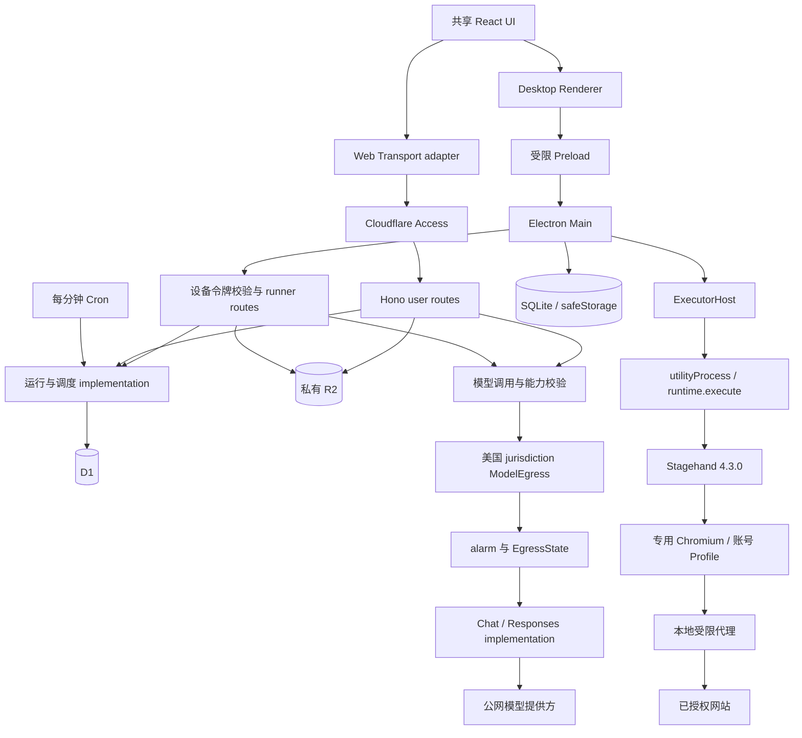
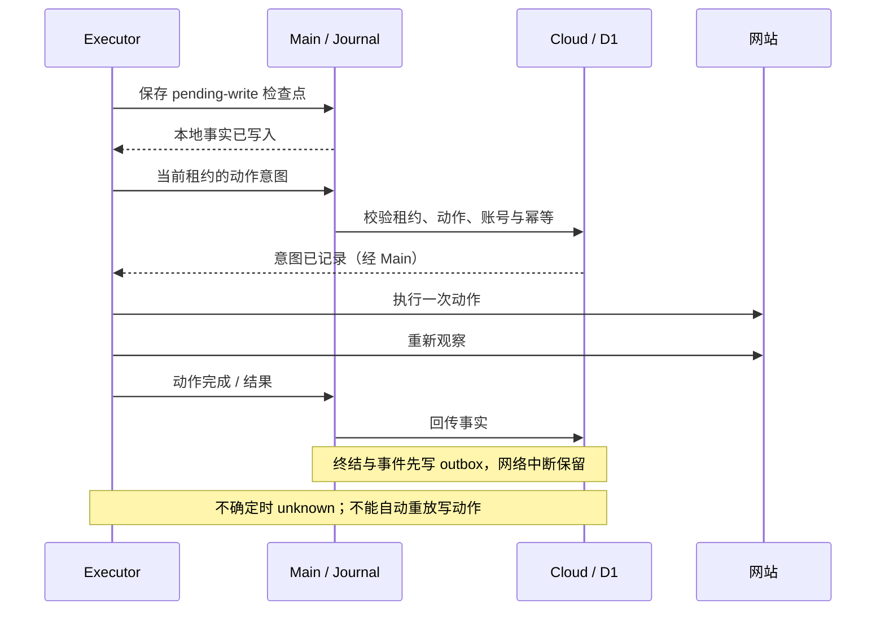
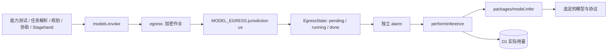

# TaskRelay 架构现状与改进候选

分析日期：2026-11-03（Asia/Shanghai）。源码基线：`923143af8276a36a7d59a11a7d1916d591d860f1`，版本 0.1.0。本文结合 `improve-codebase-architecture`、`codebase-design` 和独立源码走读，描述当前 implementation；候选建议尚未实施。

仓库仅有一个初始提交，不能根据提交频率推断热点。本次围绕运行状态、执行器恢复、人工协助与模型出站分析；未发现 `GLOSSARY.md` 或 `docs/adr/`，领域名称沿用共享协议。验收结论引用现有记录，不表示本次重新执行了模型、安装或现场测试。

## 1. 运行拓扑与职责

图中的 module 不必对应一个文件。尤其运行状态和人工协助目前跨多个文件实现；图不意味着这些规则已经集中。

| 位置 | 当前责任与关键入口 |
| --- | --- |
| `apps/web` | Vite 站点；`src/main.tsx` 为共享 UI 提供同源 fetch adapter。`wrangler.jsonc` 同时配置静态资源、Worker、D1、R2、ModelEgress 和 Cron |
| `packages/ui` | 自行设计的 React/shadcn/ui 界面：任务、对话、运行、设置及桌面状态；通过 `Transport` 使用宿主能力 |
| `packages/contracts` | Zod 数据校验、领域类型、限额、动作策略、成功判据、调度和公共地址检查；不拥有云端数据库状态 |
| `apps/cloud/src/index.ts` | Hono 入口、中间件、认证路由挂载与定时入口；`worker.ts` 额外导出 Durable Object |
| `user.ts` / `pairing.ts` | 任务、模型、账号、设备、设置、对话、取消、只读核查和设备配对 |
| `runner.ts` / `store.ts` | 领取、心跳、意图、事件、模型规划、协助消费、终结、调度及账号锁；状态 SQL 目前分布在二者及 `user.ts` |
| `models.ts` / `egress*.ts` / `model-egress.ts` | 模型配置解密、能力探测、结构化生成、用量记录，以及美国区域后台出站 |
| `packages/model` | Chat Completions 与 Responses 的请求/响应转换、用量与错误分类；不自行选择模型或管理任务 |
| `apps/desktop/src/main` | 生命周期、托盘、自启动、云端连接、令牌、SQLite、浏览器所有权与 ExecutorHost；保持 UI 重载和执行生命周期独立 |
| `apps/desktop/src/preload` / `shared/ipc.ts` | 向 Renderer 暴露有限命名入口；Main 另校验来源、参数与请求路径 |
| `apps/desktop/src/executor` | 独立 utilityProcess 中的任务循环、Stagehand、公共网络代理与页面证据；通过 Main 中转云端请求 |
| `scripts` / `forge.config.mts` | 浏览器资源准备、哈希验证、运行依赖暂存、Squirrel.Windows 打包、产物 smoke 和验收清单 |

`Transport` 已有 Web fetch 与 Desktop Preload 两种实际 adapter，值得保留。Preload 的 `request(method, path, body)` 仍是通用请求入口，权限依赖 Main 的允许列表和后端 Schema，不应描述成每项业务均有独立强类型 IPC。

## 2. 领域与协议

| 术语 | 当前含义 |
| --- | --- |
| `TaskDefinition` | 可编辑任务的版本化定义，包含网站、账号、允许操作、成功判据、时间规则、`modelId` 和 `modelVersion` |
| `TaskRun` | 某次执行，保存任务快照、状态、截止时间、设备、租约、写入事实、结果，以及可选 `reconciliationOf` |
| `HumanChallenge` | 一次需要用户协助的步骤；类型为 code / scan / approval / information / unsupported，绑定运行、步骤、版本与租约 |
| `RunEvent` | 带唯一编号、运行编号、序号、时间和脱敏内容的事件；不是保存任意页面内容的日志 |
| `ModelProfile` | 版本化的提供方地址、协议、任意模型名、价格和能力结果；返回 `hasKey`，不返回 API Key |
| `SiteAccount` | 网站账号引用；云端保存加密凭据，本机使用隔离 Profile |
| `leaseEpoch` | 云端执行租约的代次，用于拒绝过期设备回传 |
| `generation` | 本机 child 代次，用于隔离旧 utilityProcess 消息；与租约是不同机制 |
| `writePending` / `mayHaveWritten` | 当前未核实的写入意图 / 本次执行曾可能产生写入；后者不会因单个动作完成就清除 |
| `reconciliationOf` | 新的只读运行与原 `unknown` 运行的关联，不是重新执行原写操作 |

实际协议常量为 `PROTOCOL_VERSION = 1`。配对、领取等入口检查版本，设备类型使用 `protocolVersion`；并非每个对象都含 `protocol_version`。`RunEvent` 本身不含 generation/epoch，epoch 位于上传请求，generation 位于本机 IPC。

时间规则的底层表示只有 `manual`、`once`、`cron`；每日/每周由界面转换成 cron。默认时区为 `Asia/Shanghai`。共享限额为自动执行 5 分钟/40 动作、协助等待 5 分钟、心跳 15 秒、租约 90 秒、迟到 1 小时；自动执行计时扣除人工等待。全机并发 1 由云端领取及 Main/Host 守卫实现。

## 3. 任务执行与事实顺序

1. 用户描述任务，模型产生可编辑任务卡。云端校验模型能力、网站及授权，创建待验证任务和试运行；成功核验且任务版本仍匹配后才开启周期调度。
2. Cron 扫描到期任务。幂等键避免重复排队，迟到窗口只补最近一次；存在未结束或 `unknown` 运行时不继续安排同任务的周期运行。
3. 桌面主动领取。D1 batch 将运行租约、设备领取记录和账号锁协调写入；同一领取请求可幂等返回，设备忙碌或账号被锁时不分配。
4. Main 保存 claimed 检查点，创建带 generation 的 utilityProcess，启动专用浏览器并载入账号 Profile。
5. Executor 观察页面，将脱敏观察提交云端规划。模型提出单个动作，程序根据授权、目标事实和页面状态校验；高影响动作进入协助流程。
6. 对有副作用的动作，先写本地检查点，再向云端保存动作意图，随后操作页面。重新观察后标记动作完成，不因观察失败而再次点击。
7. 满足成功判据才提交结果；事件和终结事实先进入本地 outbox，上传确认后删除。Main 重连时先冲刷 outbox，再领取新任务。
8. 心跳、取消、进程异常或恢复都保留不确定性。有可能写入且无法证明结果时以 `unknown` 终结并保留账号锁；无副作用的不完整运行可失败结束。

Stagehand 负责浏览器连接、观察/提取能力及统一模型回调；任务循环由 `runtime.execute` 自行控制，并未把整段任务交给 `Stagehand.agent`。navigate/click/fill 等实际动作使用页面方法，extract 使用 Stagehand 返回的数据。模型没有任意代码、Shell 或文件访问工具。

`store.finish`、租约超时和动作意图共同维护写入不确定性。只读核查领取时转移原账号锁；成功可将原 `unknown` 标记 `succeeded/already_done`，未核实则把锁还给原运行。

当前 `assertTransition` 只有定义，没有生产调用，且把 `unknown` 声明为无后继。它与实际只读核查成功的转移不一致，**不能当作权威状态机直接接入**。

## 4. 所有人工协助共用对话通道

状态为 `pending → answered → consuming → consumed`，超时或运行结束进入 `expired` 并清理。创建、回复、消费、确认分别校验 live run、步骤、版本、租约和有效期；重复交付必须匹配同一个 deliveryId，不能换一次编号重复填写。

验证码由模型给出原文区间，程序从用户原始字符串截取，保留前导零、大小写和字符；敏感回复不写普通聊天。扫码图片短期放私有 R2；“已扫码”或“已确认”只允许继续核查，不代表站点已经通过。`unsupported` 明确终止该协助路径，不提供远程桌面或本地浏览器接管。

approval 还绑定具体操作摘要与目标事实，防止用户确认后页面变化导致批准另一项动作。Cloud 拥有协助与敏感内容生命周期，Executor 拥有填写及站点观察；这条 seam 需要保留。

## 5. 模型协议与美国区域出站

所有生产模型 HTTP 请求在这条后台链路末端发起。普通 Worker 的访客请求上下文不传给模型提供方；不能以普通 HTTP 转发或 placement hint 代替当前 alarm 出站。当前固定的是美国 jurisdiction，不固定某一个 colo，也不构成提供方永远接受请求的保证。

`EgressState` 在发请求前持久化 running；中断恢复后返回 `MODEL_CALL_OUTCOME_UNKNOWN`，不再次调用提供方。请求和分块结果使用 `MASTER_KEY` 与上下文加密，ACK 后删除，超时作业清理。测试通过存储 adapter 验证状态，不用于证明实际地区。

模型名不限制 GPT，默认 Chat Completions，可选 Responses。连接、工具调用、结构化输出是必需能力，图像输入独立测试。支持 JSON Schema 时使用严格输出；仅 JSON 模式时本地校验；格式修复预算最多一次。用量来自响应，没有 token 或价格时显示未知。

目前结构化输出有三套 implementation：

| 位置 | 实际用途 |
| --- | --- |
| `apps/cloud/src/models.ts` 的 `generate` | 生产 Zod Schema 校验与一次修复；修复保持能力所选的输出模式 |
| `apps/cloud/src/runner.ts` 的 Stagehand 路由 | 生产 Ajv 校验与一次修复；修复使用 JSON mode，行为与上行存在差异 |
| `packages/model/src/index.ts` 的 `structured` | 只被 `tests/model.test.ts` 调用，没有生产调用 |

第三套的测试通过不能证明前两套的修复预算、模式和错误处理。首选改进是让生产与测试共享同一结构化输出 interface，保留 Zod/Ajv 的校验差异和地区出站 seam。

## 6. 存储、认证和设备生命周期

| 存储/位置 | 权威范围与保留事实 |
| --- | --- |
| D1 | 任务版本、运行快照、租约、账号锁、事件、挑战、设备、模型配置/用量和证据索引。密钥、账号凭据和敏感回复加密保存 |
| Durable Object storage | 单次模型出站的短期加密请求、运行事实与分块结果；不承担任务调度 |
| 私有 R2 | 人工协助所需短期图片等证据，由元数据约束访问与清理 |
| 本地 SQLite | `config/cache/journal/outbox`；WAL、FULL、busy timeout，当前 schema version 1，拒绝读取未来版本作为可写库 |
| Windows safeStorage | Main 持有的设备令牌加密；Renderer 只读脱敏状态 |
| Chromium Profile | 按账号隔离的站点会话；不上传到云端或诊断包 |

完整 D1 结构在 `apps/cloud/migrations/0001` 至 `0004`。`schema.ts` 仅有 tasks/devices 的 Drizzle 声明，`user.ts` 的部分读取实际使用 Drizzle；大部分状态修改使用直接 D1 SQL。不能宣称 ORM 已统一管理所有表或迁移。

网站由 Access JWT 的 issuer、audience 与 owner 邮箱校验身份。桌面打开系统浏览器完成配对，取回可吊销设备令牌；云端校验哈希、撤销状态和协议版本。公开的配对开始/轮询入口另有有效期、轮询凭据和数量限制，不等于公开设备访问。

Main 控制应用生命周期，关窗口隐藏至托盘，退出停止领取并清理自有进程。浏览器恢复清理检查可执行文件和 Profile 的命令行身份，不能仅凭旧 PID 杀进程。安装环境下原生资源路径使用 `realpathSync.native` 处理 MSIX 文件重定向。

Stagehand 固定 4.3.0，Executor 打包保持原生动态 import。Forge Squirrel 生成 Windows x64 安装包，Electron 内置运行时；浏览器/扩展在 ASAR 外，构建前验证清单与哈希。首版升级走新安装包，尚无自动更新。

## 7. 当前测试证据与缺口

详见 [ACCEPTANCE.md](ACCEPTANCE.md)。下表区分实际测试 surface，避免把相邻路径的通过当作生产行为的证明。

| 验证 | 已有证据覆盖 | 不能据此证明 |
| --- | --- | --- |
| 26 项源码测试 | 协议转换、状态/幂等、策略、协助绑定和清理、出站加密及未知结果不重放 | 所有生产路径或整机故障都已覆盖 |
| D1 stand-in | `tests/helpers.ts` 用 Node SQLite 加载真实迁移，并模拟 prepare/batch | Cloudflare D1 的真实并发、网络、部署一致性 |
| EgressState 测试 | 内存 storage adapter、alarm 状态和中断恢复；本地 jurisdiction 不支持时拒绝旁路 | 真实请求地理位置或提供方可用性 |
| 模型协议测试 | Chat / Responses 转换、未知用量、错误分类、重定向拒绝 | 生产两套结构化修复行为全部正确；非 GPT 实际闭环 |
| 已记录真实模型能力 | `gpt-6-luna / Responses` 的连接、工具、严格 Schema；独立出站 trace 美国地区 | 真实浏览器任务成功、真实 Chat、非 GPT 或图像能力 |
| 打包及安装目录 smoke | 实际 Electron utilityProcess 加载 Stagehand/内置 Chrome，自建站四类操作和 `0012aB` 原样输入 | `runtime.execute`、ExecutorHost、云端调度及恢复的完整流程 |
| UI 检查 | 手机、桌面、窄窗口及独立修复批次记录 | 所有桌面原生交互现场验收 |

smoke 走 `executor/entry.ts` 中独立手写流程，没有调用 `RuntimePort` 对应的生产 `execute`。`RuntimePort` 目前只有 entry 中的生产 adapter；不能把 smoke 计作第二个 adapter。

仍待执行：真实 GPT/非 GPT 任务闭环、真实 Chat、扫码/外部确认、提交前后强杀与断网、休眠/锁屏恢复、干净 Windows 安装/升级/卸载、中文及空格安装路径和连续七天观察。没有源码事实可以替代这些现场证据。

## 8. 架构改进候选（未实施）

以下使用技能中的 module / interface / implementation / depth / seam / adapter / leverage / locality 定义。先收拢重复知识，再判断是否需要新抽象；不把文件短或转发少自动判为 shallow。本节不定义新方法、类型或调用签名。

### A. 结构化模型输出 module — Strong，首选

- **事实**：`models.ts:118` 与 `runner.ts:206` 有两套生产修复循环；`packages/model/src/index.ts:231` 的第三套仅供测试。
- **深化方向**：集中能力模式、解析、校验、一次修复预算及错误结果；生产调用和测试经过同一 interface，Zod/Ajv 差异留在 implementation 内，保留现有出站 seam。
- **Deletion test**：删除测试专用 `structured` 不影响生产，说明它未提供生产 leverage；须先让实际生产 interface 的行为被测试，再替换这套重复 implementation。
- **现有 adapter**：真实 fetch 与测试 fetcher；ModelEgress 与测试出站 adapter。Chat/Responses 是当前函数内部两条协议 implementation，不虚构成两个 adapter 类。
- **收益与验证**：修复政策获得 locality，多个调用方获得 leverage，增加 depth；覆盖无效 JSON、Schema 不符、修复次数、输出模式、用量及未知结果不重放，替换偏离生产的测试。

### B. 运行状态与账号锁 module — Worth exploring

- **事实**：`store.ts` 的领取/终结/超时，与 `runner.ts` 的意图/协助、`user.ts` 的取消/核查共同修改状态和锁；声明中的状态图未参与执行。
- **深化方向**：深化现有 store module，将运行、写入不确定性、账号锁和只读核查规则收回同一 interface；保留 D1 原子操作和快照语义。
- **Deletion test**：删除 store 只会把复杂度散回路由，说明已有 depth；它不是需要删除的 shallow 转发。
- **现有 seam / adapter**：D1 与 SQLite stand-in 已支持替换依赖；不新增只有一个实现的通用存储 module。
- **收益与验证**：状态规则提升 locality，各路由获得 leverage；保留行为测试，补终结/超时/取消交错和核查锁转移。先澄清实际状态语义，不能直接接入现有 `assertTransition`。

### C. 执行器恢复 module — Worth exploring

- **事实**：runtime 产生检查点，`ExecutorHost.recover` 和 `retire` 分别解释，Journal 接收通用载荷。`retire` 识别 `payload.status === "unknown"`，`recover` 未做同一判断；云端写入事实通常再次保守纠正，不能据此直接断言已误放锁。
- **深化方向**：集中检查点语义、终结事实保留、恢复判断和 outbox 规则；保留 Main/utilityProcess seam、generation/lease 守卫和先停止本机进程的顺序。
- **Deletion test**：删除 Journal 会扩散 SQLite implementation；需要补足的是恢复含义的 depth，不是再添加通用存取转发。
- **adapter 状态**：RuntimePort 只有一个生产 adapter；故障注入 adapter 是待建设建议，不能假称已有测试 seam 被使用。
- **收益与验证**：恢复知识获得 locality，同一 interface 覆盖停止/重启/异常带来 leverage；验证提交后强杀、终结事实排队后崩溃、离线停止及旧代次消息。保留 smoke 的打包验证用途。

### D. 人工协助生命周期 module — Worth exploring

- **事实**：`challenges.ts` 只有映射与原文截取；回复、加密、消费、ACK、清理在 user/runner/store，多轮填写与复核在 runtime。
- **深化方向**：集中云端 HumanChallenge 的状态、绑定和敏感内容清理；网站填写留在执行 implementation。运行状态通过候选 B 的 module 协作，避免双重拥有相同规则。
- **Deletion test**：删除映射只会移动字段，删除 exactReply 会重复原文校验；继续拆小函数不能自动增加整段流程的 depth。
- **现有 seam / adapter**：复用 D1/SQLite 与模型出站 adapter；网页回复者与设备消费者是不同参与者，不是同一 interface 的两个 adapter。
- **收益与验证**：协助约束获得 locality，新验证类型获得 leverage；保留已有绑定/消费行为测试，补解析期间过期/取消、交付后崩溃、确认目标变化与扫码实际复核。

优先选择 A：证据明确、范围较小，可以直接对齐生产与测试。B/C/D 涉及可靠性与责任归属，需要在选定范围后进一步设计，当前不进行实现。

## 9. 应保留的设计与文档维护

- 共享 UI 的 Transport seam 有两种实际 adapter；无需为减少文件数而合并宿主。
- EgressState 已集中持久化 running、加密分块、清理及未知结果不重放，具有 depth；ModelEgress 虽薄，承担平台 adapter 职责，不因方法少而删除。
- 云端/本机、Main/utilityProcess、授权策略/不可信页面之间的 seam 承担安全与恢复责任，应明确保留。
- 已确认的产品选型不在本轮重新争论；待选建议不写成 ADR 或现行强制规范。

协作与技能入口见 [AGENTS.md](../AGENTS.md)。未来行为变更同步本文；证据变动同步验收记录。本文的文件位置和行号是分析快照，后续以符号及实际源码为准。
