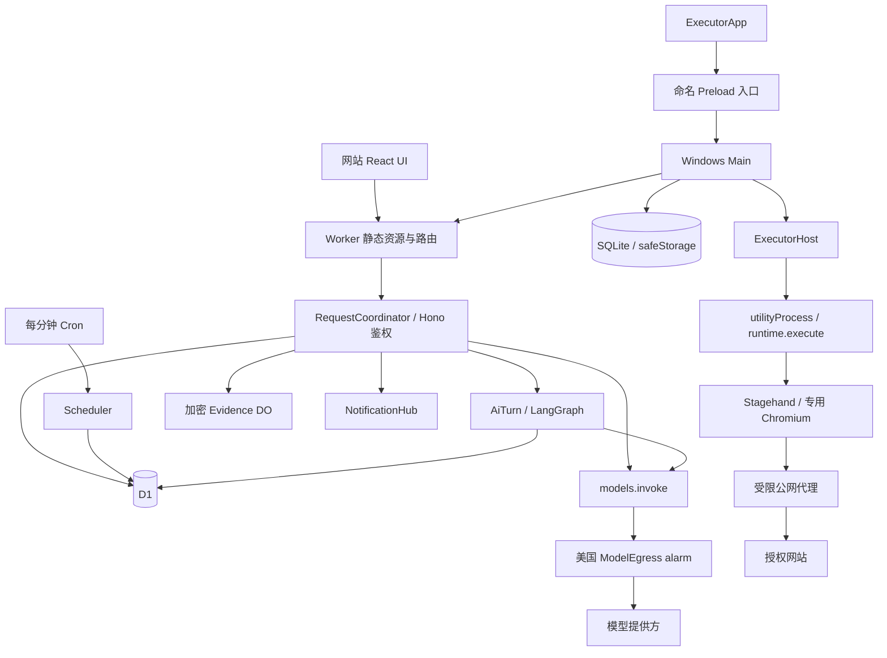
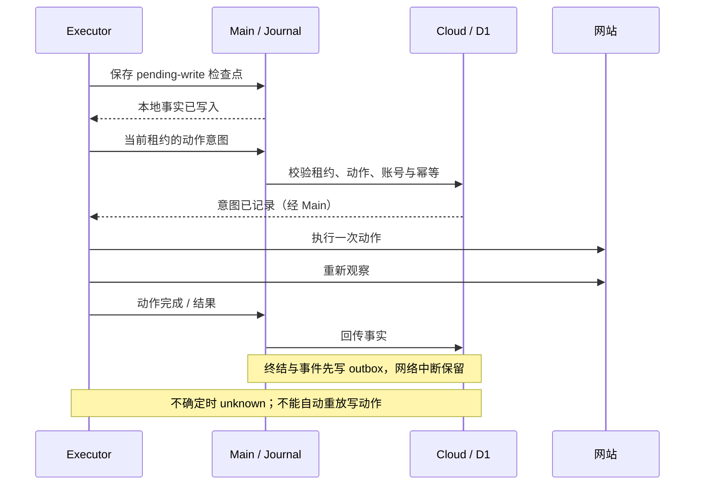
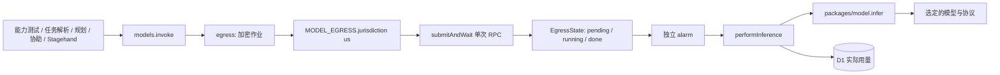

# TaskRelay 架构现状与改进候选

本文描述当前源码；部署、安装和现场验证状态分别见 [DEPLOYMENT](DEPLOYMENT.md) 与 [ACCEPTANCE](ACCEPTANCE.md)。历史实现可从 Git 追溯，不再与当前拓扑并列。

## 2026-11-04 人工协助后的规划状态

- 执行器页面观察只增加输入控件 `filled` 布尔值，不发送输入值或长度。人工输入完成后，后续规划历史明确记录协助类型、目标及已读回一致，不用泛化的“已处理”掩盖具体步骤；这不代表站点验证或任务已成功。
- 云端规划读取本次运行、当前 `leaseEpoch` 下已消费且有 deliveryId 的 code/information 目标摘要，最多 40 条；不读取 secret 或协助 instruction。未消费、过期、其他运行及旧租约协助不能成为已完成事实。已填信息不等于批准提交，具体动作仍经原批准绑定与程序核验。
- 该改动针对现场重复索取同一信息的问题，不改变授权、重放规则或模型出站链。源码与真实复验范围见验收台账。

## 2026-11-04 执行器版本更新

- Main `DesktopUpdater` 管理版本元数据、确认后的下载、哈希校验、等待与本地 Squirrel 安装。Renderer 只展示 `DesktopUpdateStatus`，Preload 只增加命名检查/下载入口；Main 原生确认框绑定当前版本，模型和任务网页不能触发更新或指定下载地址。
- 所有更新网络固定经过 CF 的 `/api/updates/windows-x64`。Worker 在进入业务 DO 前路由公开发布元数据和固定资产的流式代理；无数据库变更、R2 或模型请求。发布目录保留版本、大小及 SHA-256/SHA-1，客户端拒绝降级、预发行/不合法版本、重定向和校验失败。源文件在 CF 代理内限定到本仓库 Release 及 GitHub 资产域名；普通用户输入不能改变源地址。
- Main 下载校验后才给 Squirrel 一个应用自有本地 feed；因此 Squirrel 不读取远程 RELEASES、不直连 GitHub，也不会在活动任务期间提前解包/应用更新。安装只在同步门闩关闭新领取后启动。`RunnerPoller` 持久化领取 requestId，丢失响应须按原编号解决；等待中的 connect/flush 返回后重新检查更新门闩。
- 空闲条件是无在途/未决领取、Host 无 current/child/stopPromise/stopping/未结束 RPC、本地 journal 无未完成记录且 outbox 已清空。Host `idleForUpdate` 等待已有 RPC 完成，不能只看 activeRunId。安装重启不调用 host.stop；下载和人工等待均不打断原运行。下载失败释放更新门闩，保留用户暂停偏好；unknown 云端锁不因更新而改变。
- 协议与 SQLite schema 保持 3；旧版首次启用需要手动安装。发布准备脚本与流程见 DEPLOYMENT，实际验证/发布状态见 ACCEPTANCE。

## 2026-11-04 可靠性修复：当前基线

当前产品为多用户网站与管理员设备池，网站使用应用会话鉴权，Windows Renderer 仅运行 ExecutorApp。协议和 SQLite schema 仍为 3；D1 新增兼容迁移 `0008_report_run.sql`。状态转移以生产实现及只读核查行为为准。

- ExecutorHost 的每个异步心跳返回后重验 child、generation 和停止状态。停止期间拒绝新 RPC；浏览器清理失败保留占用，阻止新执行并允许再次清理。Main 显式提供 Electron fork adapter，测试直接调用同一 Host implementation。
- OwnedBrowser 对整个启动过程持有代次与 pending promise；close 先使启动失效，再等待并清理。读取资源期间停止不再产生迟到浏览器。execute 在迟到凭据、人工消费检查点之后再次检查取消；未知消费保留不确定性。
- 重启恢复识别 finishing 中的 unknown；恢复与正常终结复用 `finish_<runId>` outbox 键，已排队终态不能被另一条恢复事实覆盖。恢复不重放浏览器写入。
- 报告请求必须包含 runId，并在接收时校验用户与任务归属，持久化到 ai_turns。alarm 从回合读取绑定，事实只读取该运行、该次任务快照与步骤；没有绑定的旧待执行报告明确失败，不默认为最新运行。
- 成功判据仍是单个字面条件。创建提示要求多条件先澄清；程序拦截未经原文引用或手动草稿确认的分号、换行、连接词拼接，返回澄清而不生成任务卡。该检查是有限的歧义保护，不是通用自然语言逻辑解析；实际成功仍由 verifyPage 核验。
- 快照显示个人额度与平台共享预算及各自重置点。队列原因只解释当前已知阻塞条件，不能替代原子领取；本地暂停和实时网络仍可能影响可领取性。调度跳过超过迟到窗口的时隙，不生成过期排队记录。

验证与尚未完成的现场范围统一见 ACCEPTANCE 的 2026-11-04 批次。没有引入新的模型直连、调度器或通用主机工具。

## 2026-11-03 Cloudflare Free 运行架构

2026-11-04 协助补充：0.4.3 对 code/information/scan 强制非空目标，生产规划允许一次结构化修复；云端拒绝无目标挑战，执行器在请求协助前检查目标存在，避免消费回复后才发现缺少填写位置。批准点击由具体 high_impact 动作生成绑定摘要的批准请求。验证及用户暂停位置见 ACCEPTANCE 最新节。

继续使用 LangChain/LangGraph、D1 和原模型 API，不启用 Workers Paid、Queues、Workflows、Vectorize 或 LangSmith。协议与本地 schema 保持 3，D1 新增 `0007_free_runtime.sql`。

- `worker.ts` 仅处理静态资源、health 和路由；认证凭据的哈希选择 8 个 `RequestCoordinator` 分片，原始请求进入 DO 内的 Hono 完整鉴权。哈希不代表身份；不能缓存或共享权限结果。业务不再受普通 Worker 的 10 ms 请求 CPU 路径约束，仍受 DO 自身资源限制。
- 创建消息事务同时保存回合、用户消息和 `ai_dispatch` outbox，立即返回 202。每回合一个 `AiTurn` 对象，alarm 在 D1 原子领取后运行图；通知丢失由每分钟 Scheduler 补唤醒。领取后中断保持不确定，180 秒清理标为 unknown，不重放模型调用。终态通知客户端重新读取事实。
- `Scheduler` 的唯一原子范围是全局任务队列与维护；普通 HTTP 流量不集中到它。Cron 只唤醒 Scheduler，原租约、账号锁与调度规则仍在 D1。
- `NotificationHub` 使用 Hibernation WebSocket，仅推送 `changed`。连接由原认证路由建立，每次推送检查会话/设备有效性；订阅最多 8 条/对象，授权有效期 1 小时，下一次推送关闭过期连接并触发重新认证。网站隐藏时关闭订阅；快照与运行详情兜底 60 秒，活动 AI 回合 15 秒。客户端领取兜底从 4 秒变为 60 秒，运行中租约心跳仍为 15 秒。
- 证据每件独立 `Evidence` DO，最大 2 MB，500 KB 分块 AES-GCM，AAD 绑定对象 key 与分块序号；最长 10 分钟，alarm、读取过期校验和原业务清理共同生效。生产没有 R2 绑定；旧桶保留且不再使用。测试专用 DEV adapter 保留原内存 R2 夹具，不是生产回退。
- `ModelEgress` 的美国 jurisdiction、alarm、单次 submitAndWait 和持久化后 ACK 保持不变；AI 回合 DO 与请求 DO 均不能直接调用模型提供方。
- Stagehand Schema 使用锁定 Zod 4.6.7 的 `fromJSONSchema` 转换与原始输出校验，兼容 SDK 的 2020-12 Schema；独立 registry 防止 schema ID 累积/碰撞。该 API 尚属上游实验接口，升级须复跑生产路由与 workerd 回归。不在 Workers 中动态编译 Ajv，也不丢弃校验后直接信任模型输出。官方语义见 [Zod JSON Schema](https://zod.dev/json-schema?id=zfromjsonschema)。
- 项目级 UTC 日预算：100 次模型请求、50 个新 AI 回合、100 件短期证据；每请求分片 8000 次普通请求，运行恢复路径可至 9600。预算先预占、未知不退还。这些是保守的应用准入预算，不是 Cloudflare 账户计量的精确副本；其他应用、异常流量和存储增长仍可能耗尽免费额度。达到上限返回 429，不付费扩容。上海日个人额度另行保留，页面展示的个人额度不能代表平台剩余额度。
- 保留期清理跳过已失效数据，避免每分钟重复改写墓碑和会话版本。已存在成员读取不再反复更新成员记录；设备 last_seen 至少间隔 60 秒写入。
- 0.4.1 执行代理通过固定 Cloudflare HTTPS DNS 获取 A/AAAA，拒绝任意非公网答案，连接固定在已校验 IP。避免本机 TUN fake-IP 被误当成目的地址；不放开私网、任意端口或证书校验。真实网站流程和剩余验证限制见 ACCEPTANCE。

删除测试：普通 Worker 不能承载本次图计算；移除 outbox 会使 202 后唤醒丢失无从恢复；移除 ModelEgress 会丢失已验证的地区出站边界。因此这三类 adapter 分别承担运行时、可靠性和地区知识，不能让调用方复制其实现。

## 2026-11-03 LangChain / LangGraph：当前实现

0.3.0 引入协议 3、SQLite schema 3、D1 迁移 `0006_ai.sql`，生产历史切换已执行。其 CPU 阻断及后续免费架构解决情况见上节与验收台账。

- `apps/cloud/src/ai/graph.ts` 编排 compose、chat、plan、report，以及滚动 summary。状态只保存结构化结果；原始输入的 digest 防止相同 graph ID 被替换。检查点可恢复已完成图，结果不确定的模型调用保持 unknown，不自动重发。浏览器动作仍由独立 Executor 执行，图没有 Shell、JavaScript、文件工具或浏览器写操作。
- `RelayChatModel` 是 LangChain BaseChatModel adapter，结构化生成复用 `models.generateStructured`。生产链路仍为 `invoke → egress → 美国 ModelEgress alarm`；Chat Completions 和 Responses 均保留。关闭框架隐式重试；仅已收到但校验不通过的输出允许一次格式修复。调用 ID、输入 digest、额度预留和加密结果落在 D1，收到结果先保存再 ACK。
- `D1Checkpointer` 实现 LangGraph saver 的 checkpoint、parent、namespace、metadata、pending writes 和排序；`D1MemoryStore` 实现按用户隔离的 LangGraph store。检查点、pending writes、记忆和模型结果加密。使用 LangGraph 自带序列化器保留消息类型。删除/变更记忆通过事务失效旧图，迟到写入受 SQL 条件约束。
- CPU 优化后的图版本为 `relay-2`：合并空检查/验证节点，模型调用前后仍执行 guard，结构化输出及恢复结果仍校验，检查点保持同步持久化。typed serializer 字节采用 Base64 字符串保存，读取兼容原数字数组；AES-GCM、AAD 和密钥不变。回退版本必须支持此编码，不可直接回退到只支持数字数组的实现。
- Better Auth 按 D1 绑定和认证/邮件配置复用实例，不缓存用户会话，角色与撤销仍查询数据库。Zod Schema 仅缓存静态 JSON Schema；只需模型配置的路径不解密 API Key。历史裁剪一次计算各条消息字节，保留原预算规则。性能脚本仅启动隔离的本机 workerd，使用合成模型响应，不接生产数据或出站链路。
- `ai_threads/ai_turns/ai_messages` 是会话与消息事实源，独立于 LangGraph 检查点。创建草稿、缺失项、原始用户消息、滚动摘要均持久化；历史每页 50 条，按 seq 游标翻页，无固定 200 条截断。站点约束只从原始用户消息和明确编辑的草稿读取，摘要和助手消息不增加授权。
- 每条消息携带 `requestId/expectedVersion`；同线程只允许一个 active turn。消息、确认卡和任务更新均有版本检查，任务创建/修改确认可幂等重试。任务保存固定确认草稿对应的模型版本。跨用户归属由服务端认证决定，不接受模型提供 owner。
- 长期记忆仅允许用户在“我的记忆”明确确认后写入，最多 100 条。上下文最多读取最近 30 条偏好；不提供语义搜索，不接 Vectorize/embedding。LangSmith 云追踪和 verbose 环境开关会阻止 AI 调用，不会静默上传。
- 默认上下文预算 16000、输出预留 4096，可在模型配置调整；采用保守 UTF-8 字节估算，并计算结构化 schema 开销。旧消息按预算分段摘要，原始消息继续分页可读；单条内容无法容纳则明确失败，不静默裁掉授权约束。回合上限 180 秒，未确认结果不重放。
- 聊天/报告读取已校验归属的任务、最近运行和脱敏事件。报告是解释文本，不能修改真实运行状态；协助进行中普通聊天被拒绝，验证码仍走独立加密回复通道。
- 已确认完成的 compose 与已删除会话分开标记。保留期清除正文和派生结果，留下无正文的请求 digest 墓碑防止过期请求重新执行。显式偏好不随会话保留期自动删除，可由用户单独删除。

旧 `/tasks/compose`、`/tasks/draft`、`/tasks/:id/chat` 已移除。新入口为 `/threads`、`/threads/:id/messages`、`/threads/:id/draft`、`/memories`。客户端通过 `x-taskrelay-protocol: 3` 与设备记录共同校验版本；升级沿用原 bearer token，旧协议不得继续领取或上传。

## 1. 运行拓扑与职责

| 位置 | 当前责任与关键入口 |
| --- | --- |
| `apps/web` / `packages/ui` | 网站 Transport、任务/对话/结果/设置；独立 ExecutorApp 只展示设备状态和执行控制 |
| `packages/contracts` | Zod 协议、限额、动作策略、成功判据、调度和公共地址检查 |
| `worker.ts` / `request-coordinator.ts` / `index.ts` | 静态与更新路由、请求分片、业务鉴权与路由；Scheduler 管理队列与维护 |
| `user.ts` / `admin.ts` / `pairing.ts` | 用户归属、管理员控制、任务确认、取消、只读核查和配对 |
| `runner.ts` / `store.ts` | 领取、租约、动作意图、协助消费、终结及账号锁 |
| `ai/` | 异步回合、图、检查点、摘要与明确确认的用户记忆 |
| `models.ts` / `egress*.ts` / `model-egress.ts` | 能力探测、结构化生成、实际用量及唯一美国后台出站 |
| `packages/model` | Chat Completions / Responses 转换、Schema 投影、用量和错误分类 |
| `apps/desktop/src/main` | 生命周期、令牌、SQLite、浏览器、Host 与空闲更新；UI 重载不重启执行 |
| `preload` / `shared/ipc.ts` | 命名执行器入口；Main 校验来源和参数，无通用用户管理请求 |
| `executor` | 独立进程中的任务循环、Stagehand、网络代理与证据；通过 Main 中转云端请求 |
| `scripts` / `forge.config.mts` | 资源准备、哈希验证、运行依赖暂存、打包、smoke 和发布清单 |

网站使用 Better Auth 会话与已验证邮箱。设备 bearer token 只访问设备和租约绑定入口；`/api/device/user/*` 固定拒绝。Access 只作为可选外层限制。管理员运维列表不返回其他用户的任务、对话、凭据或结果正文。

云端同时守卫设备并发 1、用户并发 1（含人工等待），按最久未领取用户、再按队列时间分配。账号首次领取绑定设备；迁移要求旧执行停止且无活动/unknown 运行或账号锁，创建新浏览器环境并重新登录。无账号任务用独立任务环境；共享设备必须可信，Profile 不对设备管理员保密。

上海日默认额度为启动 5、启用周期任务 3、排队 5、对话请求 50、模型请求 200/用户及 2000/全站；还受上文更严格的 UTC 平台预算约束。启动在领取时计数，模型出站前预占，重试不重复扣启动额度，未知调用不重放。

## 2. 领域与协议

| 术语 | 当前含义 |
| --- | --- |
| `TaskDefinition` | 可编辑任务的版本化定义，包含网站、账号、允许操作、成功判据、时间规则、`modelId` 和 `modelVersion` |
| `TaskRun` | 某次执行，保存任务快照、状态、截止时间、设备、租约、写入事实、结果，以及可选 `reconciliationOf` |
| `HumanChallenge` | 一次需要用户协助的步骤；类型为 code / scan / approval / information / unsupported，绑定运行、步骤、版本与租约 |
| `RunEvent` | 带唯一编号、运行编号、序号、时间和脱敏内容的事件；不是保存任意页面内容的日志 |
| `ModelProfile` | 版本化的提供方地址、协议、任意模型名、价格和能力结果；返回 `hasKey`，不返回 API Key |
| `SiteAccount` | 网站账号引用；云端保存加密凭据，本机使用隔离 Profile |
| `leaseEpoch` | 云端执行租约的代次，用于拒绝过期设备回传 |
| `generation` | 本机 child 代次，用于隔离旧 utilityProcess 消息；与租约是不同机制 |
| `writePending` / `mayHaveWritten` | 当前未核实的写入意图 / 本次执行曾可能产生写入；后者不会因单个动作完成就清除 |
| `reconciliationOf` | 新的只读运行与原 `unknown` 运行的关联，不是重新执行原写操作 |

实际协议常量为 `PROTOCOL_VERSION = 3`。配对、领取等入口检查版本，设备类型使用 `protocolVersion`；并非每个对象都含 `protocol_version`。`RunEvent` 本身不含 generation/epoch，epoch 位于上传请求，generation 位于本机 IPC。

时间规则的底层表示只有 `manual`、`once`、`cron`；每日/每周由创建对话转换成 cron，确认卡展示可读时间并允许详细编辑。默认时区为 `Asia/Shanghai`。共享限额为自动执行 5 分钟/40 动作、协助等待 5 分钟、心跳 15 秒、租约 90 秒、迟到 1 小时；自动执行计时扣除人工等待。全机并发 1 由云端领取及 Main/Host 守卫实现。

### 界面与任务草稿

网站 AI 交互规则见 [AGENTS.md](../AGENTS.md#ui-专项要求)，实际检查见 [UI-REVIEW](UI-REVIEW.md)。共享组合位于 `packages/ui`，网站用 `App`，Windows 用独立 `ExecutorApp`；共享主题不意味着桌面拥有任务编辑和聊天入口。

`task-compose.tsx` / `use-thread.ts` 经 `/threads`、`/threads/:id/messages` 持久化多轮草稿；`task-summary.tsx` 展示确认卡，`task-editor.tsx` 只修改草稿。确认后才创建/更新任务或试运行，保留模型版本、授权、能力和幂等校验。旧 `/tasks/compose`、`/tasks/draft` 与任务 chat 入口已移除。

`conversation.tsx` 处理历史、当前回合和绑定协助；`run-report.tsx` 展示真实事件与选中运行的报告。敏感回复不回显，过期或绑定切换清空输入；离线、已回复、过期或不支持的挑战不能提交。批准提交显式确认及原绑定，拒绝取消整次运行；扫码完成仍要求实际网站复核。请求代次防止旧查询覆盖新状态。

## 3. 任务执行与事实顺序

1. 用户描述任务，模型产生可编辑任务卡；用户明确确认后，云端校验模型能力、网站及授权，创建待验证任务和试运行；成功核验且任务版本仍匹配后才开启周期调度。
2. Cron 扫描到期任务。幂等键避免重复排队，迟到窗口只补最近一次；存在未结束或 `unknown` 运行时不继续安排同任务的周期运行。
3. 桌面主动领取。D1 batch 将运行租约、设备领取记录和账号锁协调写入；同一领取请求可幂等返回，设备忙碌或账号被锁时不分配。
4. Main 保存 claimed 检查点，创建带 generation 的 utilityProcess，启动专用浏览器并载入账号 Profile。
5. Executor 观察页面，将脱敏观察提交云端规划。模型提出单个动作，程序根据授权、目标事实和页面状态校验；高影响动作进入协助流程。
6. 对有副作用的动作，先写本地检查点，再向云端保存动作意图，随后操作页面。重新观察后标记动作完成，不因观察失败而再次点击。
7. 满足成功判据才提交结果；事件和终结事实先进入本地 outbox，上传确认后删除。Main 重连时先冲刷 outbox，再领取新任务。
8. 心跳、取消、进程异常或恢复都保留不确定性。有可能写入且无法证明结果时以 `unknown` 终结并保留账号锁；无副作用的不完整运行可失败结束。

Stagehand 负责浏览器连接、观察/提取能力及统一模型回调；任务循环由 `runtime.execute` 自行控制，并未把整段任务交给 `Stagehand.agent`。navigate/click/fill 等实际动作使用页面方法，extract 使用 Stagehand 返回的数据。模型没有任意代码、Shell 或文件访问工具。

`store.finish`、租约超时和动作意图共同维护写入不确定性。只读核查领取时转移原账号锁；成功可将原 `unknown` 标记 `succeeded/already_done`，未核实则把锁还给原运行。

无调用且与只读核查冲突的旧 `assertTransition` 状态表已删除。实际转移仍由 store/runner/user 的事务条件共同守卫，尚未集中为单一状态机。

## 4. 所有人工协助共用对话通道

状态为 `pending → answered → consuming → consumed`，超时或运行结束进入 `expired` 并清理。创建、回复、消费、确认分别校验 live run、步骤、版本、租约和有效期；重复交付必须匹配同一个 deliveryId，不能换一次编号重复填写。

验证码由模型给出原文区间，程序从用户原始字符串截取，保留前导零、大小写和字符；敏感回复不写普通聊天。扫码图片短期放加密 Evidence DO；“已扫码”或“已确认”只允许继续核查，不代表站点已经通过。`unsupported` 明确终止该协助路径，不提供远程桌面或本地浏览器接管。

approval 还绑定具体操作摘要与目标事实，防止用户确认后页面变化导致批准另一项动作。Cloud 拥有协助与敏感内容生命周期，Executor 拥有填写及站点观察；这条 seam 需要保留。

## 5. 模型协议与美国区域出站

所有生产模型 HTTP 请求在这条后台链路末端发起。普通 Worker 的访客请求上下文不传给模型提供方；不能以普通 HTTP 转发或 placement hint 代替当前 alarm 出站。当前固定的是美国 jurisdiction，不固定某一个 colo，也不构成提供方永远接受请求的保证。

`EgressState` 在发请求前持久化 running；中断恢复后返回 `MODEL_CALL_OUTCOME_UNKNOWN`，不再次调用提供方。请求和分块结果使用 `MASTER_KEY` 与上下文加密，ACK 后删除，超时作业清理。测试通过存储 adapter 验证状态，不用于证明实际地区。

提交与等待使用一次 `submitAndWait` RPC；90 秒等待期限与内部唤醒由 `EgressState` 拥有。alarm 期间没有新的外部查询 RPC，返回终态后才 ack。这样避免 DO 共享 I/O 上下文被新进入的访客等待请求替换；原来的 `submit → RPC wait` 在新域名实际触发地区拒绝，修复后新旧域名和网页真实推理通过。`ModelEgress` 继续作为平台 adapter，不增加并行的出站通道。诊断 trace 与真实推理必须分别验收。

模型名不限制 GPT，默认 Chat Completions，可选 Responses。连接、工具调用、结构化输出是必需能力，图像输入独立测试。支持 JSON Schema 时使用严格输出；仅 JSON 模式时本地校验；格式修复预算最多一次。用量来自响应，没有 token 或价格时显示未知。

结构化输出已统一到 `models.generateStructured`：能力选择、JSON 解析、本地校验及一次修复预算由同一 module 拥有。`generate` 是 Zod adapter；Stagehand 路由使用 `stagehandSchema` 的 Zod 校验调用同一 interface。两次调用保持能力所选模式及模型版本，传输/未知结果错误在校验 catch 外传播，不触发格式修复。每次调用仍经 invoke、美国 alarm、performInference 记录实际用量。

删除了 `packages/model` 中仅用于测试的 `structured`。`tests/structured-production.test.ts` 直接调用 Hono plan/Stagehand 路由，经过真实 egress 与 EgressState；仅替换平台存储和外部 HTTP，覆盖两种协议、两种输出能力、修复预算、版本固定、用量、地区不可用及错误不重放。这是生产路径的隔离测试，不是新的真实云端验收。

## 6. 存储、认证和设备生命周期

| 存储/位置 | 权威范围与保留事实 |
| --- | --- |
| D1 | 任务版本、运行快照、租约、账号锁、事件、挑战、设备、模型配置/用量和证据索引。密钥、账号凭据和敏感回复加密保存 |
| SQLite Durable Objects | 请求分片、Scheduler 唤醒、AI 回合、模型出站、短期加密证据及休眠通知；任务/租约事实仍在 D1 |
| 本地 SQLite | `config/cache/journal/outbox`；WAL、FULL、busy timeout，当前 schema version 3，拒绝读取未来版本作为可写库 |
| Windows safeStorage | Main 持有的设备令牌加密；Renderer 只读脱敏状态 |
| Chromium Profile | 按账号隔离的站点会话；不上传到云端或诊断包 |

完整 D1 结构以 `apps/cloud/migrations/` 的 SQL 迁移为准（目前 0001 至 0008）。`schema.ts` 仅保留实际查询使用的 tasks 声明，认证表另在 `auth-schema.ts`，`user.ts` 的部分读取实际使用 Drizzle；大部分状态修改使用直接 D1 SQL。不能宣称 ORM 已统一管理所有表或迁移。

网站通过 Better Auth 会话与已验证邮箱校验身份，服务端实施用户归属与管理员角色隔离。桌面打开系统浏览器完成配对，取回可吊销设备令牌；云端校验哈希、撤销状态和协议版本。公开的配对开始/轮询入口另有有效期、轮询凭据和数量限制，不等于公开设备访问。

Main 控制应用生命周期，关窗口隐藏至托盘，退出停止领取并清理自有进程。浏览器恢复清理检查可执行文件和 Profile 的命令行身份，不能仅凭旧 PID 杀进程。安装环境下原生资源路径使用 `realpathSync.native` 处理 MSIX 文件重定向。

Stagehand 固定 4.3.0，Executor 打包保持原生动态 import。Forge Squirrel 生成 Windows x64 安装包，Electron 内置运行时；浏览器/扩展在 ASAR 外，构建前验证清单与哈希。0.4.7 起实现确认下载与空闲更新；发布通道和真实升级验收状态见验收台账。

## 7. 验证与交付边界

测试数量、版本与现场证据统一见 [ACCEPTANCE](ACCEPTANCE.md)，不在架构文档重复维护阶段统计。D1 的 Node SQLite stand-in 不证明真实 D1 并发；EgressState 的隔离测试不证明实际地区；模型能力通过不等于浏览器任务闭环。

打包 smoke 使用 `executor/entry.ts` 的独立流程，不调用生产 `runtime.execute` 或 ExecutorHost。生产执行与恢复另有 `executor-runtime.test.ts` / `executor-host.test.ts` 的隔离故障 adapter；这些测试也不替代真实整机故障、安装和长期观察。

Windows 扩展加载由 Main 的 `extension.ts` 管理：正式启动与 smoke 都将 ASAR 外的 Stagehand 扩展逐文件读取，按文件名与 SHA-256 生成内容目录，写入应用拥有的 runtime-extensions，完整核对后再传给独立 Executor。缓存缺失时原子准备，已存在但内容被改动或出现额外文件时拒绝加载，符号链接不作为扩展文件接受。此 adapter 处理安装目录下 Chromium 将内容脚本加载为空的现场问题，不修改 SDK、Chromium 权限或模型/页面工具边界。原安装扩展的固定公钥仍用于 CDP origin 限制。

自检报告记录实际客户端版本、程序/资源/扩展路径与 ASAR 哈希；验收清单同时检查报告新鲜度、版本、构建 ASAR 和实际安装文件，安装目录来自报告，不按 LOCALAPPDATA 猜测。`sourceDirty` 标记生成清单时工作区是否含未提交改动，`sourceCommit` 仍只是当时 Git 基线，不能把未提交构建冒充干净 tag 构建。原始清单含本机路径，仅供本地验收。

## 8. 架构候选与保留决定

以下采用 codebase-design 的 module、interface、depth、seam、adapter、leverage 与 locality 术语。候选不代表授权重构；现有改动及测试不能被描述成整体收敛已经完成。

| 候选 | 当前事实与 deletion test | 状态及后续验证 |
| --- | --- | --- |
| 结构化模型输出 module | 修复预算、校验和错误传播已集中到 `generateStructured` interface；删除重复循环提高 locality，调用方复用产生 leverage | 已实施；保留唯一出站 seam 和生产路由测试 |
| 运行状态与账号锁 module | store/runner/user 共同修改状态和锁；删除 store 会使事务知识扩散到调用方，已有 depth 应保留 | Worth exploring；收拢规则前核对取消/超时/终结交错与只读核查锁转移，复用 D1/SQLite adapter |
| 执行器恢复 module | Host recover/retire 仍解释 runtime 检查点；删除 Journal 会扩散 SQLite implementation | unknown 恢复与 finish outbox 幂等已修复，故障 adapter 已使用；整体收敛仍为候选，保持进程 seam 和代次/租约守卫 |
| 人工协助生命周期 module | 映射/原文截取在 challenges，回复/消费/清理跨 user/runner/store；删除 exactReply 会重复原文校验 | Worth exploring；云端生命周期可改善 locality，页面填写保留在 Executor；验证解析时过期、消费后崩溃与批准目标变化 |

`packages/model/src/schema.ts` 仅投影提供方支持的严格输出语法，原始约束仍在 `generateStructured` 校验，不能把投影后的宽松 Schema 当作任务授权校验。

应保留的平台 adapter：Web Transport、命名 Preload、ModelEgress、RelayChatModel、D1Checkpointer、D1MemoryStore 和 Journal。删除它们会把宿主、地区、加密或持久化知识扩散到调用方；文件短不等于冗余。云端/本机、Main/utilityProcess、可信策略/不可信页面的 seam 继续承担安全与恢复责任。

## 2026-11-03 创建对话的无协议域名识别

`task-sites.ts` 仅从用户消息识别完整 HTTPS 地址或明确的 ASCII 域名；无协议域名补全 HTTPS，路径和查询保留。规范化地址作为上下文传给模型，原消息不改写；助手消息不贡献站点授权。`publicUrl`、模型输出 origin 集合校验、确认后创建以及执行时 DNS 公网检查继续生效。显式 HTTP/其他协议、邮箱、凭据、私网和非标准端口不通过这一识别入口。国际化域名可使用完整 HTTPS 地址。
