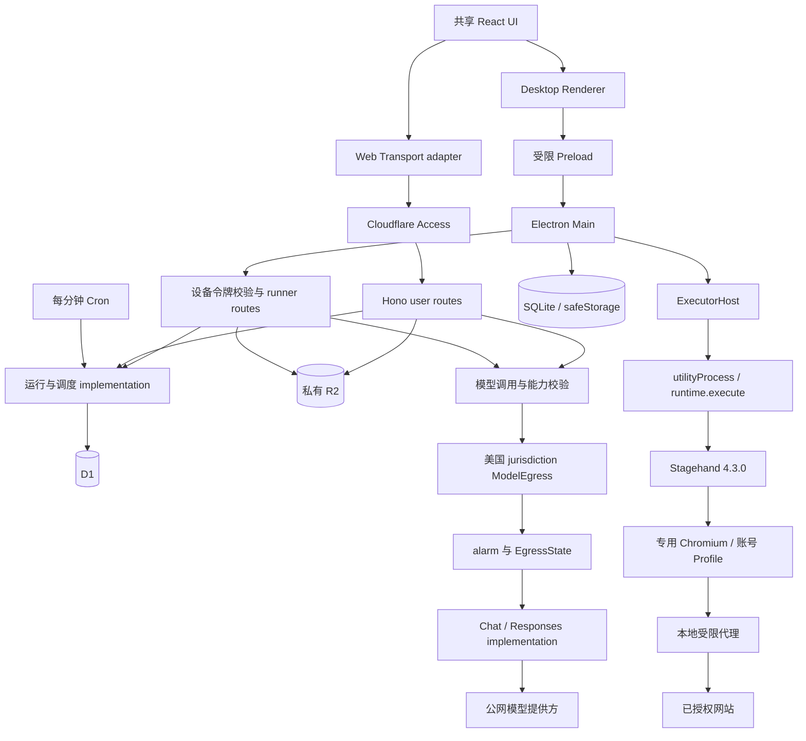
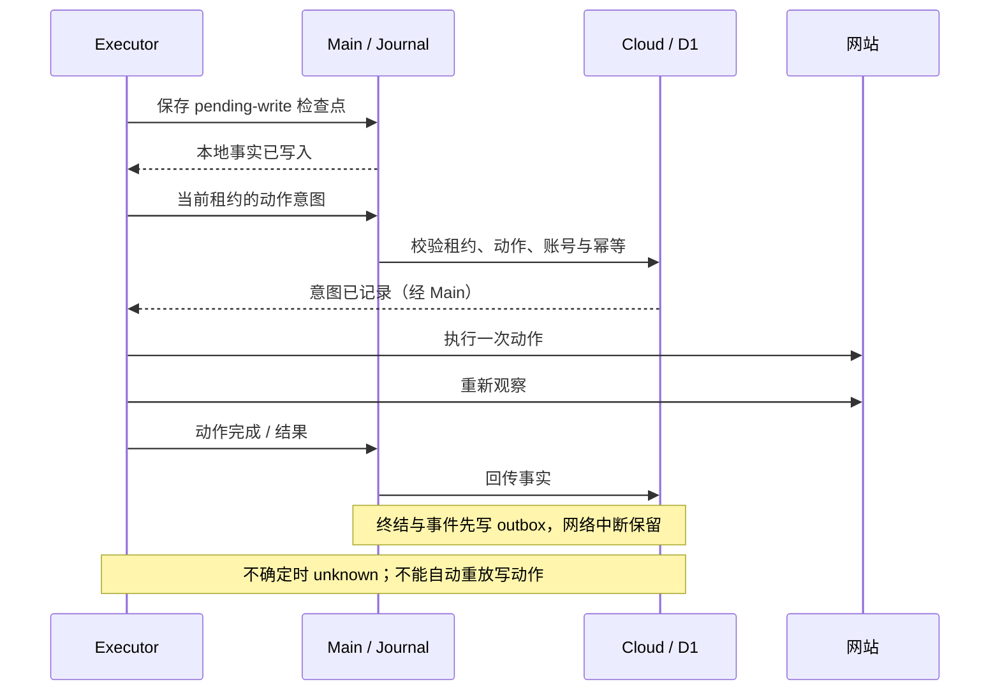
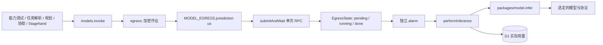

# TaskRelay 架构现状与改进候选

## 2026-11-04 可靠性修复：当前基线

当前产品为多用户网站与管理员设备池，网站使用应用会话鉴权，Windows Renderer 仅运行 ExecutorApp。协议和 SQLite schema 仍为 3；D1 新增兼容迁移 `0008_report_run.sql`。下方明确标注的旧版本分析只保留决策依据，不作为当前入口、拓扑或部署状态说明。

- ExecutorHost 的每个异步心跳返回后重验 child、generation 和停止状态。停止期间拒绝新 RPC；浏览器清理失败保留占用，阻止新执行并允许再次清理。Main 显式提供 Electron fork adapter，测试直接调用同一 Host implementation。
- OwnedBrowser 对整个启动过程持有代次与 pending promise；close 先使启动失效，再等待并清理。读取资源期间停止不再产生迟到浏览器。execute 在迟到凭据、人工消费检查点之后再次检查取消；未知消费保留不确定性。
- 重启恢复识别 finishing 中的 unknown；恢复与正常终结复用 `finish_<runId>` outbox 键，已排队终态不能被另一条恢复事实覆盖。恢复不重放浏览器写入。
- 报告请求必须包含 runId，并在接收时校验用户与任务归属，持久化到 ai_turns。alarm 从回合读取绑定，事实只读取该运行、该次任务快照与步骤；没有绑定的旧待执行报告明确失败，不默认为最新运行。
- 成功判据仍是单个字面条件。创建提示要求多条件先澄清；程序拦截未经原文引用或手动草稿确认的分号、换行、连接词拼接，返回澄清而不生成任务卡。该检查是有限的歧义保护，不是通用自然语言逻辑解析；实际成功仍由 verifyPage 核验。
- 快照显示个人额度与平台共享预算及各自重置点。队列原因只解释当前已知阻塞条件，不能替代原子领取；本地暂停和实时网络仍可能影响可领取性。调度跳过超过迟到窗口的时隙，不生成过期排队记录。

验证与尚未完成的现场范围统一见 ACCEPTANCE 的 2026-11-04 批次。没有引入新的模型直连、调度器或通用主机工具。

## 2026-11-03 Cloudflare Free 运行架构

2026-11-04 协助补充：0.4.3 对 code/information/scan 强制非空目标，生产规划允许一次结构化修复；云端拒绝无目标挑战，执行器在请求协助前检查目标存在，避免消费回复后才发现缺少填写位置。批准点击由具体 high_impact 动作生成绑定摘要的批准请求。验证及用户暂停位置见 ACCEPTANCE 最新节。

本节优先于下方历史版本。继续使用 LangChain/LangGraph、D1 和原模型 API，不启用 Workers Paid、Queues、Workflows、Vectorize 或 LangSmith。协议与本地 schema 保持 3，D1 新增 `0007_free_runtime.sql`。

- `worker.ts` 仅处理静态资源、health 和路由；认证凭据的哈希选择 8 个 `RequestCoordinator` 分片，原始请求进入 DO 内的 Hono 完整鉴权。哈希不代表身份；不能缓存或共享权限结果。业务不再受普通 Worker 的 10 ms 请求 CPU 路径约束，仍受 DO 自身资源限制。
- 创建消息事务同时保存回合、用户消息和 `ai_dispatch` outbox，立即返回 202。每回合一个 `AiTurn` 对象，alarm 在 D1 原子领取后运行图；通知丢失由每分钟 Scheduler 补唤醒。领取后中断保持不确定，180 秒清理标为 unknown，不重放模型调用。终态通知客户端重新读取事实。
- `Scheduler` 的唯一原子范围是全局任务队列与维护；普通 HTTP 流量不集中到它。Cron 只唤醒 Scheduler，原租约、账号锁与调度规则仍在 D1。
- `NotificationHub` 使用 Hibernation WebSocket，仅推送 `changed`。连接由原认证路由建立，每次推送检查会话/设备有效性；订阅最多 8 条/对象，授权有效期 1 小时，下一次推送关闭过期连接并触发重新认证。网站隐藏时关闭订阅；快照与运行详情兜底 60 秒，活动 AI 回合 15 秒。客户端领取兜底从 4 秒变为 60 秒，运行中租约心跳仍为 15 秒。
- 证据每件独立 `Evidence` DO，最大 2 MB，500 KB 分块 AES-GCM，AAD 绑定对象 key 与分块序号；最长 10 分钟，alarm、读取过期校验和原业务清理共同生效。生产没有 R2 绑定；旧桶保留且不再使用。测试专用 DEV adapter 保留原内存 R2 夹具，不是生产回退。
- `ModelEgress` 的美国 jurisdiction、alarm、单次 submitAndWait 和持久化后 ACK 保持不变；AI 回合 DO 与请求 DO 均不能直接调用模型提供方。
- Stagehand Schema 使用锁定 Zod 4.6.7 的 `fromJSONSchema` 转换与原始输出校验，兼容 SDK 的 2020-12 Schema；独立 registry 防止 schema ID 累积/碰撞。该 API 尚属上游实验接口，升级须复跑生产路由与 workerd 回归。不在 Workers 中动态编译 Ajv，也不丢弃校验后直接信任模型输出。官方语义见 [Zod JSON Schema](https://zod.dev/json-schema?id=zfromjsonschema)。
- 项目级 UTC 日预算：100 次模型请求、50 个新 AI 回合、100 件短期证据；每请求分片 8000 次普通请求，运行恢复路径可至 9600。预算先预占、未知不退还。这些是保守的应用准入预算，不是 Cloudflare 账户计量的精确副本；其他应用、异常流量和存储增长仍可能耗尽免费额度。达到上限返回 429，不付费扩容。上海日个人额度另行保留，页面展示的个人额度不能代表平台剩余额度。
- 保留期清理跳过已失效数据，避免每分钟重复改写墓碑和会话版本。已存在成员读取不再反复更新成员记录；设备 last_seen 至少间隔 60 秒写入。
- 0.4.1 执行代理通过固定 Cloudflare HTTPS DNS 获取 A/AAAA，拒绝任意非公网答案，连接固定在已校验 IP。避免本机 TUN fake-IP 被误当成目的地址；不放开私网、任意端口或证书校验。真实网站流程和剩余验证限制见 ACCEPTANCE。

删除测试：普通 Worker 不能承载本次图计算；移除 outbox 会使 202 后唤醒丢失无从恢复；移除 ModelEgress 会丢失已验证的地区出站边界。因此这三类 adapter 分别承担运行时、可靠性和地区知识，不能让调用方复制其实现。

## 2026-11-03 LangChain / LangGraph：当前实现

0.3.0 引入协议 3、SQLite schema 3、D1 迁移 `0006_ai.sql`，生产历史切换已执行。其 CPU 阻断及后续免费架构解决情况见上节与验收台账。

- `apps/cloud/src/ai/graph.ts` 编排 compose、chat、plan、report，以及滚动 summary。状态只保存结构化结果；原始输入的 digest 防止相同 graph ID 被替换。检查点可恢复已完成图，结果不确定的模型调用保持 unknown，不自动重发。浏览器动作仍由独立 Executor 执行，图没有 Shell、JavaScript、文件工具或浏览器写操作。
- `RelayChatModel` 是 LangChain BaseChatModel adapter，结构化生成复用 `models.generateStructured`。生产链路仍为 `invoke → egress → 美国 ModelEgress alarm`；Chat Completions 和 Responses 均保留。关闭框架隐式重试；仅已收到但校验不通过的输出允许一次格式修复。调用 ID、输入 digest、额度预留和加密结果落在 D1，收到结果先保存再 ACK。
- `D1Checkpointer` 实现 LangGraph saver 的 checkpoint、parent、namespace、metadata、pending writes 和排序；`D1MemoryStore` 实现按用户隔离的 LangGraph store。检查点、pending writes、记忆和模型结果加密。使用 LangGraph 自带序列化器保留消息类型。删除/变更记忆通过事务失效旧图，迟到写入受 SQL 条件约束。
- CPU 优化后的图版本为 `relay-2`：合并空检查/验证节点，模型调用前后仍执行 guard，结构化输出及恢复结果仍校验，检查点保持同步持久化。typed serializer 字节采用 Base64 字符串保存，读取兼容原数字数组；AES-GCM、AAD 和密钥不变。回退版本必须支持此编码，不可直接回退到只支持数字数组的实现。
- Better Auth 按 D1 绑定和认证/邮件配置复用实例，不缓存用户会话，角色与撤销仍查询数据库。Zod Schema 仅缓存静态 JSON Schema；只需模型配置的路径不解密 API Key。历史裁剪一次计算各条消息字节，保留原预算规则。性能脚本仅启动隔离的本机 workerd，使用合成模型响应，不接生产数据或出站链路。
- `ai_threads/ai_turns/ai_messages` 是会话与消息事实源，独立于 LangGraph 检查点。创建草稿、缺失项、原始用户消息、滚动摘要均持久化；历史每页 50 条，按 seq 游标翻页，无固定 200 条截断。站点约束只从原始用户消息和明确编辑的草稿读取，摘要和助手消息不增加授权。
- 每条消息携带 `requestId/expectedVersion`；同线程只允许一个 active turn。消息、确认卡和任务更新均有版本检查，任务创建/修改确认可幂等重试。任务保存固定确认草稿对应的模型版本。跨用户归属由服务端认证决定，不接受模型提供 owner。
- 长期记忆仅允许用户在“我的记忆”明确确认后写入，最多 100 条。上下文最多读取最近 30 条偏好；不提供语义搜索，不接 Vectorize/embedding。LangSmith 云追踪和 verbose 环境开关会阻止 AI 调用，不会静默上传。
- 默认上下文预算 16000、输出预留 4096，可在模型配置调整；采用保守 UTF-8 字节估算，并计算结构化 schema 开销。旧消息按预算分段摘要，原始消息继续分页可读；单条内容无法容纳则明确失败，不静默裁掉授权约束。回合上限 180 秒，未确认结果不重放。
- 聊天/报告读取已校验归属的任务、最近运行和脱敏事件。报告是解释文本，不能修改真实运行状态；协助进行中普通聊天被拒绝，验证码仍走独立加密回复通道。
- 已确认完成的 compose 与已删除会话分开标记。保留期清除正文和派生结果，留下无正文的请求 digest 墓碑防止过期请求重新执行。显式偏好不随会话保留期自动删除，可由用户单独删除。

旧 `/tasks/compose`、`/tasks/draft`、`/tasks/:id/chat` 已移除。新入口为 `/threads`、`/threads/:id/messages`、`/threads/:id/draft`、`/memories`。客户端通过 `x-taskrelay-protocol: 3` 与设备记录共同校验版本；升级沿用原 bearer token，旧协议不得继续领取或上传。

## 2026-11-03 多人网站与公共执行器实施

本节覆盖下方 0.1.0 分析中已变更的事实。网站使用 Better Auth 与独立 `auth_*` D1 表，Brevo 发送验证/重置邮件；只有验证过的 owner 邮箱绑定 `legacy_owner` 管理员。网站分为个人任务/账号/对话/结果/用量与管理员模型/设备/配额/运维。管理员运维列表不返回其他用户的任务、对话、凭据或结果正文。

协议已升级至 v2。设备令牌只访问状态、领取和租约绑定的执行接口；`/api/device/user/*` 固定拒绝，Preload 不再暴露通用管理请求。桌面 Renderer 使用独立 `ExecutorApp`，仅显示连接、运行编号、忙闲、暂停、停止、自启动及诊断。Main/utilityProcess 隔离、代次检查、检查点、未知写入锁和恢复规则保持。

`0005_multiuser.sql` 保留旧 ID 和密文，将旧数据归属原 owner。D1 不接受 populated table 上带非空默认值的 REFERENCES 新列，因此四个历史表使用非空归属列加成员存在/删除/改名触发器；新认证表和配额表保留声明式外键。认证 adapter 关闭交互事务；密码写入触发器原子撤销会话。重置先消费令牌，中断不会复用；用户需重新申请链接。异常交由固定错误映射，避免认证库打印带参数的 SQL 错误。

云端领取同时守卫设备并发 1、用户并发 1（含人工等待），按最久未领取用户、再按任务队列时间分配。站点账号首次领取原子绑定设备，离线等待；迁移必须确认旧执行停止，且无活动/未知运行及账号锁，创建新浏览器环境并提示重新登录。无账号任务用独立任务环境。共享设备属于管理员可信环境，Profile 不构成对设备管理员的保密边界。

上海日额度：启动 5、启用周期任务 3、排队 5、对话请求 50、模型请求 200/用户及 2000/全站。启动在领取时计数，重试不重复扣减；模型出站前预占，修复也计数，未知不重放。模型仍唯一通过美国区域 ModelEgress alarm 出站。

本地 SQLite schema 升至 2，清空旧管理缓存，保留 config/journal/outbox；恢复所需 Profile 映射保留。0.2.0 已打包、安装并验证桌面入口。当前上线仍关闭公开注册和领取；已验证及未完成现场项目见 [验收记录](ACCEPTANCE.md)。下方历史共享 UI、Access owner 校验、通用 Preload、协议 1 和 schema 1 描述不再代表当前实现。

分析日期：2026-11-03（Asia/Shanghai）。源码基线：`923143af8276a36a7d59a11a7d1916d591d860f1`，版本 0.1.0。本文结合 `improve-codebase-architecture`、`codebase-design` 和独立源码走读。2026-11-03 后续实施已统一结构化输出；其余候选仍未实施。

初始分析时仓库只有一个提交，不能据此推断热点。后续已分阶段提交文档、结构化输出，并实现共享默认主题和聊天式任务创建。未发现 `GLOSSARY.md` 或 `docs/adr/`，领域名称沿用共享协议。本轮验证范围见第 7 节及验收记录，历史模型和安装证据不自动代表本次复验。

## 历史 0.1.0 分析（以下第 1–9 节不代表当前拓扑）

## 1. 运行拓扑与职责

图中的 module 不必对应一个文件。尤其运行状态和人工协助目前跨多个文件实现；图不意味着这些规则已经集中。

| 位置 | 当前责任与关键入口 |
| --- | --- |
| `apps/web` | Vite 站点；`src/main.tsx` 为共享 UI 提供同源 fetch adapter。`wrangler.jsonc` 同时配置静态资源、Worker、D1、R2、ModelEgress 和 Cron |
| `packages/ui` | 自行设计的 React/shadcn/ui 界面：任务、对话、运行、设置及桌面状态；通过 `Transport` 使用宿主能力 |
| `packages/contracts` | Zod 数据校验、领域类型、限额、动作策略、成功判据、调度和公共地址检查；不拥有云端数据库状态 |
| `apps/cloud/src/index.ts` | Hono 入口、中间件、认证路由挂载与定时入口；`worker.ts` 额外导出 Durable Object |
| `user.ts` / `pairing.ts` | 任务、模型、账号、设备、设置、对话、取消、只读核查和设备配对 |
| `runner.ts` / `store.ts` | 领取、心跳、意图、事件、模型规划、协助消费、终结、调度及账号锁；状态 SQL 目前分布在二者及 `user.ts` |
| `models.ts` / `egress*.ts` / `model-egress.ts` | 模型配置解密、能力探测、结构化生成、用量记录，以及美国区域后台出站 |
| `packages/model` | Chat Completions 与 Responses 的请求/响应转换、用量与错误分类；不自行选择模型或管理任务 |
| `apps/desktop/src/main` | 生命周期、托盘、自启动、云端连接、令牌、SQLite、浏览器所有权与 ExecutorHost；保持 UI 重载和执行生命周期独立 |
| `apps/desktop/src/preload` / `shared/ipc.ts` | 向 Renderer 暴露有限命名入口；Main 另校验来源、参数与请求路径 |
| `apps/desktop/src/executor` | 独立 utilityProcess 中的任务循环、Stagehand、公共网络代理与页面证据；通过 Main 中转云端请求 |
| `scripts` / `forge.config.mts` | 浏览器资源准备、哈希验证、运行依赖暂存、Squirrel.Windows 打包、产物 smoke 和验收清单 |

`Transport` 已有 Web fetch 与 Desktop Preload 两种实际 adapter，值得保留。Preload 的 `request(method, path, body)` 仍是通用请求入口，权限依赖 Main 的允许列表和后端 Schema，不应描述成每项业务均有独立强类型 IPC。

## 2. 领域与协议

| 术语 | 当前含义 |
| --- | --- |
| `TaskDefinition` | 可编辑任务的版本化定义，包含网站、账号、允许操作、成功判据、时间规则、`modelId` 和 `modelVersion` |
| `TaskRun` | 某次执行，保存任务快照、状态、截止时间、设备、租约、写入事实、结果，以及可选 `reconciliationOf` |
| `HumanChallenge` | 一次需要用户协助的步骤；类型为 code / scan / approval / information / unsupported，绑定运行、步骤、版本与租约 |
| `RunEvent` | 带唯一编号、运行编号、序号、时间和脱敏内容的事件；不是保存任意页面内容的日志 |
| `ModelProfile` | 版本化的提供方地址、协议、任意模型名、价格和能力结果；返回 `hasKey`，不返回 API Key |
| `SiteAccount` | 网站账号引用；云端保存加密凭据，本机使用隔离 Profile |
| `leaseEpoch` | 云端执行租约的代次，用于拒绝过期设备回传 |
| `generation` | 本机 child 代次，用于隔离旧 utilityProcess 消息；与租约是不同机制 |
| `writePending` / `mayHaveWritten` | 当前未核实的写入意图 / 本次执行曾可能产生写入；后者不会因单个动作完成就清除 |
| `reconciliationOf` | 新的只读运行与原 `unknown` 运行的关联，不是重新执行原写操作 |

实际协议常量为 `PROTOCOL_VERSION = 1`。配对、领取等入口检查版本，设备类型使用 `protocolVersion`；并非每个对象都含 `protocol_version`。`RunEvent` 本身不含 generation/epoch，epoch 位于上传请求，generation 位于本机 IPC。

时间规则的底层表示只有 `manual`、`once`、`cron`；每日/每周由创建对话转换成 cron，确认卡展示可读时间并允许详细编辑。默认时区为 `Asia/Shanghai`。共享限额为自动执行 5 分钟/40 动作、协助等待 5 分钟、心跳 15 秒、租约 90 秒、迟到 1 小时；自动执行计时扣除人工等待。全机并发 1 由云端领取及 Main/Host 守卫实现。

### 共享界面与任务草稿

交互约定：网站与 Windows 客户端的 AI 交互以 [shadcn/ui AI Elements](https://ui.shadcn.com/docs/ai-elements) 为准，组件选用、状态呈现和验证要求统一维护在 [AGENTS.md 的 UI 交互基准](../AGENTS.md#ui-交互基准)。“Codex 式”仅作为整体布局描述。当前共享入口已覆盖 Chat、Message、Prompt Input、Suggestion、Model Selector、Tool 和 Confirmation 的组合；没有接通的附件、流式输出、思考强度或停止生成能力不展示控件，具体检查范围见 UI-REVIEW。

`app.tsx` 负责任务侧栏、导航、主题及宿主状态；`chat-parts.tsx` 组合官方 Message/MessageScroller/Bubble/InputGroup/Marker，`model-selector.tsx` 按实际能力呈现可选配置。`conversation.tsx` 协调消息、轮询与绑定协助；`run-report.tsx` 通过 Trace/CodeBlock 呈现实际事件、证据与结果，`challenge-panel.tsx` 通过 Confirmation 的 Item 组合呈现操作与选择。网站与桌面使用同一套默认 shadcn/ui 中性色 tokens，桌面能力仍通过 Transport/Preload/Main。

`task-compose.tsx` 持有当前草稿和短期补全对话。`POST /tasks/compose` 使用统一 `generate`，缺网址直接追问，信息不足返回 `task: null`；模型新增站点必须出现在用户输入或当前草稿中。草稿不落库、不排队。`task-summary.tsx` 展示确认卡，`task-editor.tsx` 仅修改草稿。确认后才调用原有创建/版本更新路由，保留能力、账号、授权和试运行校验。创建失败保留相同 requestId 与载荷，版本更新冲突要求核对新版本。旧 `/tasks/draft` 保留兼容。

运行对话和修改配置是不同操作；普通聊天不修改任务。敏感协助回复不回显为消息，步骤或版本切换时清空输入；UI 禁止离线、已回复、不支持或过期挑战的提交，最终绑定校验仍由后端负责。

确认按钮仍向 `/challenges/:id/reply` 提交显式确认文本及原绑定；拒绝按钮向 `/runs/:id/cancel` 请求取消整次运行，不伪造协助消费结果。扫码完成只是请求实际网站核查。已提交但快照尚未更新时，当前协助按钮保持禁用；过期计时会主动清空输入。轮询使用请求代次隔离，发送前启动的旧查询不能覆盖本轮对话结果。

## 3. 任务执行与事实顺序

1. 用户描述任务，模型产生可编辑任务卡。云端校验模型能力、网站及授权，创建待验证任务和试运行；成功核验且任务版本仍匹配后才开启周期调度。
2. Cron 扫描到期任务。幂等键避免重复排队，迟到窗口只补最近一次；存在未结束或 `unknown` 运行时不继续安排同任务的周期运行。
3. 桌面主动领取。D1 batch 将运行租约、设备领取记录和账号锁协调写入；同一领取请求可幂等返回，设备忙碌或账号被锁时不分配。
4. Main 保存 claimed 检查点，创建带 generation 的 utilityProcess，启动专用浏览器并载入账号 Profile。
5. Executor 观察页面，将脱敏观察提交云端规划。模型提出单个动作，程序根据授权、目标事实和页面状态校验；高影响动作进入协助流程。
6. 对有副作用的动作，先写本地检查点，再向云端保存动作意图，随后操作页面。重新观察后标记动作完成，不因观察失败而再次点击。
7. 满足成功判据才提交结果；事件和终结事实先进入本地 outbox，上传确认后删除。Main 重连时先冲刷 outbox，再领取新任务。
8. 心跳、取消、进程异常或恢复都保留不确定性。有可能写入且无法证明结果时以 `unknown` 终结并保留账号锁；无副作用的不完整运行可失败结束。

Stagehand 负责浏览器连接、观察/提取能力及统一模型回调；任务循环由 `runtime.execute` 自行控制，并未把整段任务交给 `Stagehand.agent`。navigate/click/fill 等实际动作使用页面方法，extract 使用 Stagehand 返回的数据。模型没有任意代码、Shell 或文件访问工具。

`store.finish`、租约超时和动作意图共同维护写入不确定性。只读核查领取时转移原账号锁；成功可将原 `unknown` 标记 `succeeded/already_done`，未核实则把锁还给原运行。

当前 `assertTransition` 只有定义，没有生产调用，且把 `unknown` 声明为无后继。它与实际只读核查成功的转移不一致，**不能当作权威状态机直接接入**。

## 4. 所有人工协助共用对话通道

状态为 `pending → answered → consuming → consumed`，超时或运行结束进入 `expired` 并清理。创建、回复、消费、确认分别校验 live run、步骤、版本、租约和有效期；重复交付必须匹配同一个 deliveryId，不能换一次编号重复填写。

验证码由模型给出原文区间，程序从用户原始字符串截取，保留前导零、大小写和字符；敏感回复不写普通聊天。扫码图片短期放私有 R2；“已扫码”或“已确认”只允许继续核查，不代表站点已经通过。`unsupported` 明确终止该协助路径，不提供远程桌面或本地浏览器接管。

approval 还绑定具体操作摘要与目标事实，防止用户确认后页面变化导致批准另一项动作。Cloud 拥有协助与敏感内容生命周期，Executor 拥有填写及站点观察；这条 seam 需要保留。

## 5. 模型协议与美国区域出站

所有生产模型 HTTP 请求在这条后台链路末端发起。普通 Worker 的访客请求上下文不传给模型提供方；不能以普通 HTTP 转发或 placement hint 代替当前 alarm 出站。当前固定的是美国 jurisdiction，不固定某一个 colo，也不构成提供方永远接受请求的保证。

`EgressState` 在发请求前持久化 running；中断恢复后返回 `MODEL_CALL_OUTCOME_UNKNOWN`，不再次调用提供方。请求和分块结果使用 `MASTER_KEY` 与上下文加密，ACK 后删除，超时作业清理。测试通过存储 adapter 验证状态，不用于证明实际地区。

提交与等待使用一次 `submitAndWait` RPC；90 秒等待期限与内部唤醒由 `EgressState` 拥有。alarm 期间没有新的外部查询 RPC，返回终态后才 ack。这样避免 DO 共享 I/O 上下文被新进入的访客等待请求替换；原来的 `submit → RPC wait` 在新域名实际触发地区拒绝，修复后新旧域名和网页真实推理通过。`ModelEgress` 继续作为平台 adapter，不增加并行的出站通道。诊断 trace 与真实推理必须分别验收。

模型名不限制 GPT，默认 Chat Completions，可选 Responses。连接、工具调用、结构化输出是必需能力，图像输入独立测试。支持 JSON Schema 时使用严格输出；仅 JSON 模式时本地校验；格式修复预算最多一次。用量来自响应，没有 token 或价格时显示未知。

结构化输出已统一到 `models.generateStructured`：能力选择、JSON 解析、本地校验及一次修复预算由同一 module 拥有。`generate` 是 Zod adapter；Stagehand 路由预先编译 Ajv Schema 后调用同一 interface。两次调用保持能力所选模式及模型版本，传输/未知结果错误在校验 catch 外传播，不触发格式修复。每次调用仍经 invoke、美国 alarm、performInference 记录实际用量。

删除了 `packages/model` 中仅用于测试的 `structured`。`tests/structured-production.test.ts` 直接调用 Hono plan/Stagehand 路由，经过真实 egress 与 EgressState；仅替换平台存储和外部 HTTP，覆盖两种协议、两种输出能力、修复预算、版本固定、用量、地区不可用及错误不重放。这是生产路径的隔离测试，不是新的真实云端验收。

## 6. 存储、认证和设备生命周期

| 存储/位置 | 权威范围与保留事实 |
| --- | --- |
| D1 | 任务版本、运行快照、租约、账号锁、事件、挑战、设备、模型配置/用量和证据索引。密钥、账号凭据和敏感回复加密保存 |
| Durable Object storage | 单次模型出站的短期加密请求、运行事实与分块结果；不承担任务调度 |
| 私有 R2 | 人工协助所需短期图片等证据，由元数据约束访问与清理 |
| 本地 SQLite | `config/cache/journal/outbox`；WAL、FULL、busy timeout，当前 schema version 1，拒绝读取未来版本作为可写库 |
| Windows safeStorage | Main 持有的设备令牌加密；Renderer 只读脱敏状态 |
| Chromium Profile | 按账号隔离的站点会话；不上传到云端或诊断包 |

完整 D1 结构在 `apps/cloud/migrations/0001` 至 `0004`。`schema.ts` 仅有 tasks/devices 的 Drizzle 声明，`user.ts` 的部分读取实际使用 Drizzle；大部分状态修改使用直接 D1 SQL。不能宣称 ORM 已统一管理所有表或迁移。

网站由 Access JWT 的 issuer、audience 与 owner 邮箱校验身份。桌面打开系统浏览器完成配对，取回可吊销设备令牌；云端校验哈希、撤销状态和协议版本。公开的配对开始/轮询入口另有有效期、轮询凭据和数量限制，不等于公开设备访问。

Main 控制应用生命周期，关窗口隐藏至托盘，退出停止领取并清理自有进程。浏览器恢复清理检查可执行文件和 Profile 的命令行身份，不能仅凭旧 PID 杀进程。安装环境下原生资源路径使用 `realpathSync.native` 处理 MSIX 文件重定向。

Stagehand 固定 4.3.0，Executor 打包保持原生动态 import。Forge Squirrel 生成 Windows x64 安装包，Electron 内置运行时；浏览器/扩展在 ASAR 外，构建前验证清单与哈希。首版升级走新安装包，尚无自动更新。

## 7. 当前测试证据与缺口

详见 [ACCEPTANCE.md](ACCEPTANCE.md)。下表区分实际测试 surface，避免把相邻路径的通过当作生产行为的证明。

| 验证 | 已有证据覆盖 | 不能据此证明 |
| --- | --- | --- |
| 68 项源码测试 | 协议、状态/幂等、策略、协助、出站；实际 plan/Stagehand/草稿/聊天/验证回复路由的修复与美国出站；多轮确认与创建幂等；严格 Schema 投影和 JSON 指令；单次 RPC 等待及超时 | 所有故障交错或整机故障都已覆盖 |
| D1 stand-in | `tests/helpers.ts` 用 Node SQLite 加载真实迁移，并模拟 prepare/batch | Cloudflare D1 的真实并发、网络、部署一致性 |
| EgressState 测试 | 内存 storage adapter、alarm 状态和中断恢复；单次提交等待、终态确认失败不丢结果、90 秒超时；本地 jurisdiction 不支持时拒绝旁路 | Cloudflare 的实际 I/O 上下文行为、真实请求地理位置或提供方可用性 |
| 模型协议测试 | Chat / Responses 转换、未知用量、错误分类、重定向拒绝 | 非 GPT 实际闭环；隔离测试不能证明云端网络可用 |
| 已记录真实模型能力 | `gpt-6-luna / Responses` 的连接、工具、严格 Schema；独立出站 trace 美国地区 | 真实浏览器任务成功、真实 Chat、非 GPT 或图像能力 |
| 打包及安装目录 smoke | 实际 Electron utilityProcess 加载 Stagehand/内置 Chrome，自建站四类操作和 `0012aB` 原样输入 | `runtime.execute`、ExecutorHost、云端调度及恢复的完整流程 |
| UI 检查 | 共享 App 演示 Transport 下的桌面/手机/窄窗口、创建、错误恢复、协助和默认主题，见 UI-REVIEW | 真实模型联调、桌面 IPC、所有原生交互现场验收 |

smoke 走 `executor/entry.ts` 中独立手写流程，没有调用 `RuntimePort` 对应的生产 `execute`。`RuntimePort` 目前只有 entry 中的生产 adapter；不能把 smoke 计作第二个 adapter。

Windows 扩展加载由 Main 的 `extension.ts` 管理：正式启动与 smoke 都将 ASAR 外的 Stagehand 扩展逐文件读取，按文件名与 SHA-256 生成内容目录，写入应用拥有的 runtime-extensions，完整核对后再传给独立 Executor。缓存缺失时原子准备，已存在但内容被改动或出现额外文件时拒绝加载，符号链接不作为扩展文件接受。此 adapter 处理安装目录下 Chromium 将内容脚本加载为空的现场问题，不修改 SDK、Chromium 权限或模型/页面工具边界。原安装扩展的固定公钥仍用于 CDP origin 限制。

自检报告记录实际客户端版本、程序/资源/扩展路径与 ASAR 哈希；验收清单同时检查报告新鲜度、版本、构建 ASAR 和实际安装文件，安装目录来自报告，不按 LOCALAPPDATA 猜测。`sourceDirty` 标记生成清单时工作区是否含未提交改动，`sourceCommit` 仍只是当时 Git 基线，不能把未提交构建冒充干净 tag 构建。原始清单含本机路径，仅供本地验收。

仍待执行：真实 GPT/非 GPT 任务闭环、真实 Chat、扫码/外部确认、提交前后强杀与断网、休眠/锁屏恢复、干净 Windows 安装/升级/卸载、中文及空格安装路径和连续七天观察。没有源码事实可以替代这些现场证据。

## 8. 架构改进候选（未实施）

以下使用技能中的 module / interface / implementation / depth / seam / adapter / leverage / locality 定义。先收拢重复知识，再判断是否需要新抽象；不把文件短或转发少自动判为 shallow。A 的实际 implementation 见第 5 节；B/C/D 不定义新方法、类型或调用签名。

### A. 结构化模型输出 module — 已实施（以下保留原分析依据）

- **事实**：`models.ts:118` 与 `runner.ts:206` 有两套生产修复循环；`packages/model/src/index.ts:231` 的第三套仅供测试。
- **深化方向**：集中能力模式、解析、校验、一次修复预算及错误结果；生产调用和测试经过同一 interface，Zod/Ajv 差异留在 implementation 内，保留现有出站 seam。
- **Deletion test**：删除测试专用 `structured` 不影响生产，说明它未提供生产 leverage；须先让实际生产 interface 的行为被测试，再替换这套重复 implementation。
- **现有 adapter**：真实 fetch 与测试 fetcher；ModelEgress 与测试出站 adapter。Chat/Responses 是当前函数内部两条协议 implementation，不虚构成两个 adapter 类。
- **收益与验证**：修复政策获得 locality，多个调用方获得 leverage，增加 depth；覆盖无效 JSON、Schema 不符、修复次数、输出模式、用量及未知结果不重放，替换偏离生产的测试。

### B. 运行状态与账号锁 module — Worth exploring

- **事实**：`store.ts` 的领取/终结/超时，与 `runner.ts` 的意图/协助、`user.ts` 的取消/核查共同修改状态和锁；声明中的状态图未参与执行。
- **深化方向**：深化现有 store module，将运行、写入不确定性、账号锁和只读核查规则收回同一 interface；保留 D1 原子操作和快照语义。
- **Deletion test**：删除 store 只会把复杂度散回路由，说明已有 depth；它不是需要删除的 shallow 转发。
- **现有 seam / adapter**：D1 与 SQLite stand-in 已支持替换依赖；不新增只有一个实现的通用存储 module。
- **收益与验证**：状态规则提升 locality，各路由获得 leverage；保留行为测试，补终结/超时/取消交错和核查锁转移。先澄清实际状态语义，不能直接接入现有 `assertTransition`。

### C. 执行器恢复 module — 局部可靠性修复与测试已落地，整体收敛仍为候选

2026-11-04 更新：下列原分析中的 recover unknown 差异已修复，终结与恢复统一使用 finish outbox 键；正式 ExecutorHost/execute 已引入并使用进程/SDK/网络故障 adapter，相关测试见本文件顶部与验收台账。没有新建通用 Journal 转发层，也没有把完整恢复语义集中为新 module。

- **事实**：runtime 产生检查点，`ExecutorHost.recover` 和 `retire` 分别解释，Journal 接收通用载荷。`retire` 识别 `payload.status === "unknown"`，`recover` 未做同一判断；云端写入事实通常再次保守纠正，不能据此直接断言已误放锁。
- **深化方向**：集中检查点语义、终结事实保留、恢复判断和 outbox 规则；保留 Main/utilityProcess seam、generation/lease 守卫和先停止本机进程的顺序。
- **Deletion test**：删除 Journal 会扩散 SQLite implementation；需要补足的是恢复含义的 depth，不是再添加通用存取转发。
- **adapter 状态**：RuntimePort 只有一个生产 adapter；故障注入 adapter 是待建设建议，不能假称已有测试 seam 被使用。
- **收益与验证**：恢复知识获得 locality，同一 interface 覆盖停止/重启/异常带来 leverage；验证提交后强杀、终结事实排队后崩溃、离线停止及旧代次消息。保留 smoke 的打包验证用途。

### D. 人工协助生命周期 module — Worth exploring

- **事实**：`challenges.ts` 只有映射与原文截取；回复、加密、消费、ACK、清理在 user/runner/store，多轮填写与复核在 runtime。
- **深化方向**：集中云端 HumanChallenge 的状态、绑定和敏感内容清理；网站填写留在执行 implementation。运行状态通过候选 B 的 module 协作，避免双重拥有相同规则。
- **Deletion test**：删除映射只会移动字段，删除 exactReply 会重复原文校验；继续拆小函数不能自动增加整段流程的 depth。
- **现有 seam / adapter**：复用 D1/SQLite 与模型出站 adapter；网页回复者与设备消费者是不同参与者，不是同一 interface 的两个 adapter。
- **收益与验证**：协助约束获得 locality，新验证类型获得 leverage；保留已有绑定/消费行为测试，补解析期间过期/取消、交付后崩溃、确认目标变化与扫码实际复核。

A 已完成；C 的具体缺陷与故障测试已实施。B/C/D 的整体 module 收敛仍为设计候选，不能将本轮修复描述为三个架构重构全部完成。

后续真实联调补充：`packages/model/src/schema.ts` 只转换发送给兼容服务的严格输出 Schema：oneOf 转 anyOf、const 转 enum、去除未支持的 URI format 和字符串长度限制等；原始 Zod/Ajv 约束仍在 `generateStructured` 校验，校验失败最多修复一次。JSON 模式首个请求明确包含 JSON 指令及完整原始 Schema。不能把投影后的宽松约束当作任务授权校验。

## 9. 应保留的设计与文档维护

- 共享 UI 的 Transport seam 有两种实际 adapter；无需为减少文件数而合并宿主。
- EgressState 已集中持久化 running、加密分块、清理及未知结果不重放，具有 depth；ModelEgress 虽薄，承担平台 adapter 职责，不因方法少而删除。
- 云端/本机、Main/utilityProcess、授权策略/不可信页面之间的 seam 承担安全与恢复责任，应明确保留。
- 已确认的产品选型不在本轮重新争论；待选建议不写成 ADR 或现行强制规范。

协作与技能入口见 [AGENTS.md](../AGENTS.md)。未来行为变更同步本文；证据变动同步验收记录。本文的文件位置和行号是分析快照，后续以符号及实际源码为准。

## 2026-11-03 创建对话的无协议域名识别

`task-sites.ts` 仅从用户消息识别完整 HTTPS 地址或明确的 ASCII 域名；无协议域名补全 HTTPS，路径和查询保留。规范化地址作为上下文传给模型，原消息不改写；助手消息不贡献站点授权。`publicUrl`、模型输出 origin 集合校验、确认后创建以及执行时 DNS 公网检查继续生效。显式 HTTP/其他协议、邮箱、凭据、私网和非标准端口不通过这一识别入口。国际化域名可使用完整 HTTPS 地址。
