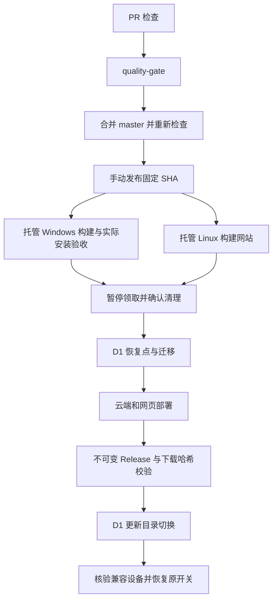

# TaskRelay 当前架构

交付由 GitHub Actions 拥有：Quality 在 PR 与 master 汇总固定 `quality-gate`，手动 Production release 只接受同一 SHA 的主分支成功报告。发布状态机以 D1 settings 的 `productionRelease` 做条件更新，保存原开关、恢复点及不可变产物引用；失败不自动恢复领取或回滚数据库。0028 触发器在领取事务中检查暂停状态，管理员设置入口拒绝与进行中的发布竞争。更新目录由 RequestCoordinator 从 D1 `desktopReleaseCatalog` 读取；Worker 只路由，旧编译目录仅作首次初始化。

Main 的浏览器关闭／下载策略和账号状态适配器统一经 LocalCdp 调用 chrome-remote-interface，删除两套请求编号、响应分发和 WebSocket 生命周期代码。LocalCdp 只校验同端口 127.0.0.1 浏览器端点、固定错误与命令超时；SDK 使用本地协议，不拉取外部协议。CRI 0.34.0 尚无公开握手选项，scripts/cdp-policy.mjs 以版本及完整上游源码 SHA-256 校验后，仅禁止重定向、设置 4 秒握手与 1 秒关闭截止；安装和生产依赖暂存均应用，依赖升级必须复审此补丁。请求超时关闭连接并拒绝后续发送；不自动重试浏览器操作。浏览器进程及退出确认仍归 Main。

网站用户／管理员路由改为 Hono 可推导链式组合，前端 hc 只导入路由类型，网络发送仍经 Transport。Transport 支持主动取消：读取取消与超时分开；写入已发出后取消仍是结果未确认。TanStack Query 管理工作空间、账号摘要、设置和本机状态读取；缓存仅在当前用户组件树内存中，退出／切换时取消并清空，无隐式重试或离线写入队列。敏感账号详情、密码与卡片草稿不进入缓存；聊天保留 requestId、会话版本及双游标协议。Better Auth React 管认证请求与会话变化，成功后仍经本人成员接口复核。模型编辑由 React Hook Form＋Zod 管理，刷新不覆盖草稿。

本文描述当前源码。部署与安装见 [DEPLOYMENT](DEPLOYMENT.md)，验证证据与未完成项见 [ACCEPTANCE](ACCEPTANCE.md)。旧版本设计从 Git 历史追溯，不与当前流程并列。

模型 HTTP 协议由官方 OpenAI SDK 接管，SDK 仅在 ModelEgress 的美国区域 alarm 内实例化，禁用自动重试与正文日志；平台 adapter 保留公网地址校验、禁止重定向、整次请求超时、响应大小上限与固定公开错误。标准 Zod 经官方结构化输出 helper 生成 wire Schema，再做提供方格式投影；原始规则仍用于最终校验，Stagehand 原始 JSON Schema 与 JSON 模式集中兼容。模型配置版本、身份、租约、用量与未知结果防重仍由云端拥有。

## 职责与事实归属

| 层                      | 职责                                                                                       |
| ----------------------- | ------------------------------------------------------------------------------------------ |
| 网站 / packages/ui      | 用户隔离的任务聊天、模型选择、账号与设置、执行过程和图片；一个输入框承接交办、补充和协助   |
| Cloudflare              | 应用鉴权、任务版本、运行快照、调度、租约、设备分配、粗步骤规划与协助图、模型出站           |
| Windows Main            | 云端连接、safeStorage 设备令牌、SQLite journal/outbox、浏览器与执行子进程生命周期          |
| Preload / Renderer      | 校验后的命名入口、连接与运行状态、暂停、停止、自启动和诊断；不提供聊天、任务编辑和模型管理 |
| Executor utilityProcess | 独立 Stagehand 4.4.0，完整观察、规划、操作、纠错与最终回复循环                             |

普通 Worker 负责静态资源、health 与路由。请求按认证凭据哈希进入 RequestCoordinator 分片后仍执行完整 Hono 鉴权；分片哈希不是用户身份。Scheduler 执行定时工作，AiTurn 通过持久化 dispatch 与 alarm 处理长对话回合，NotificationHub 用休眠 WebSocket 通知变化，客户端仍从归属校验后的接口读取事实。

Cloudflare 保持 Free，不设置项目级每日平台预算或全站模型上限，不自动付费扩容。个人次数限制当前关闭；计费用量与平台、供应商限制仍有效。平台能力或额度变动须按部署时的官方说明核对，不把免费额度当容量承诺。

## 当前聊天与执行流程

协议为 17，图版本为 `relay-graph-3`；桌面版本、安装和部署状态见验收记录。

1. 用户在网站交办。云端规划图检查意图；明确任务生成可调整的粗步骤并交接，缺少关键信息才询问，咨询直接回答。粗步骤随任务版本固化为 `executionOutline`，不含选择器，也不是强制执行清单；原话和后续补充仍完整传给桌面。
2. conversation_inbox 以 requestId/digest 接收消息；线程内串行处理回合。响应未确认时客户端跨刷新保留原 requestId；任务已启动后的重试仍先匹配原交办，不能改投为执行中补充。规划图经 understand → handoff（仅任务）→ respond，commitDecision 原子提交任务、版本与 conversation_commands，随后幂等排队。聊天展示本次真实生成的粗步骤。
3. 云端领取事务检查身份、设备并发、账号锁与租约；任务及模型配置版本固定在运行快照。Main 保存本地检查点后创建带 generation 的执行子进程，拒绝旧代次消息。
4. Executor 的官方 createAgent v2 负责决策、工具循环和普通文字结束；平台中间件负责观察、串行、协助与最终提交，使用 LangChain 原生 AIMessage / ToolMessage。模型结合粗步骤与实时页面决定具体操作：Stagehand snapshot、act、observe、extract，以及导航、切换页面、等待和求助。高层 AI 给出自然语言单步操作，不生成选择器或业务完成枚举。
5. 执行器先向云端协助图求助。云端读取已有上下文与可用账号，无法解决时才在原聊天询问用户，并停在无副作用的 interrupt 节点；回复以持久事件绑定当前问题和轮次后恢复。桌面也停在纯等待节点，轮询只读取已有协助结果，不重复浏览器操作。普通补充和当前协助回复共用消息入口。
6. 执行器用普通助手文字回复实际进度或结果；云端保存转发，不另起报告模型。reported 表示“已回复”，不代表业务全部完成，部分完成或受阻也可正常收尾。

网站发送后立即在内存回显用户消息和“正在发送”；服务端确认后替换为真实记录，失败恢复输入并沿用原 requestId 重试。通知在读取或发送途中到达时合并为待刷新，当前操作结束后补读；发送完成也立即读取最新状态。generation/revision 继续隔离旧会话和旧快照，不依赖下一次轮询补偿发送期间的通知。

聊天采用 MessageScroller 的底部跟随模式，不给历史用户行或临时回显设置 turn anchor，避免等数量节点替换重新定位到旧问题。用户上翻后由组件保留阅读位置；只有新的本地发送请求通过官方 scrollToEnd 入口主动回到最新。发送、云端推理和执行器状态共用一个持续渲染的状态行，避开 WebKit 对 content-visibility:auto 离屏动画的恢复问题；离线或刷新失败显示状态不可更新，不继续展示旧的处理中提示。

当前新交办采用 manual；条件卡与频率确认保留为产品方向，不产生新条件草稿，也不构成执行前提。旧已确认条件的兼容路由和调度底层保留；没有 confirmedCondition 的任务不显示调度开关。用户偏好可保存，但当前执行上下文未消费这些偏好，修改偏好不会撤销运行或聊天回合。

### 图与平台模块的边界

| 模块                                             | 管理的知识与状态                                                                                                      |
| ------------------------------------------------ | --------------------------------------------------------------------------------------------------------------------- |
| `ai/planning-graph.ts`、`ai/help-graph.ts`       | 云端规划、协助分支与恢复点；不操作浏览器                                                                              |
| `ai/graph.ts`、`ai/checkpointer.ts`              | 图版本、输入摘要、generation、用户归属、加密 D1 checkpoint 与 pending writes；写入同时检查聊天、回合和运行租约        |
| `ai/dispatch.ts`、`ai/turn.ts`                   | 持久事件认领与 alarm 唤醒；只推进图，不重复实现模型决策循环                                                           |
| `ai/model.ts`、`packages/model/src/langchain.ts` | 标准模型接口、云端推理 Agent 与消息适配；结构化输出仍由现有出站 adapter 校验和发送                                    |
| `executor/execution-graph.ts`                    | 官方 createAgent v2 的执行边界，p-limit(1) 按原始调用序号串行执行工具，补齐取消调用的 ToolMessage，处理同进程协助恢复 |
| `executor/runtime.ts`                            | 浏览器、页面、凭据、截图、动作登记、停止与云端通信；实现图需要的执行能力                                              |
| `executor/session-checkpointer.ts`               | 当前 utilityProcess 内最新与父 checkpoint，保留完整序列化类型；不是浏览器崩溃恢复日志                                 |

执行工具由同一份 Zod Schema 生成模型定义并进行运行时校验。afterModel 登记原始工具序号，wrapToolCall 在每次工具前重新校验停止、租约和用户指令；不依赖 maxConcurrency 保证串行。协助先冻结本批剩余调用并执行无副作用 interrupt，外层再登记云端协助；恢复后剩余旧操作返回未执行。空模型回复仅允许一次明确错误反馈后的纠正，结果未知的请求不重发。最终截图或结果提交遇到新指令时沿用同一线程继续。

云端图状态加密持久化；桌面图不跨 generation 恢复，进程故障仍由 Main journal/outbox 与租约收尾。模型结果未知不自动重试，浏览器结果未知不自动重放。图使用同步 checkpoint 和无固定回合数的递归配置；没有旧手写循环与新图同时运行。迁移保留旧记录为退休版本，不把旧 checkpoint 当作新图入口。

D1Checkpointer 在适配器内先序列化、加密，再将大密文按 500 KB 分块，索引和分块在同一 D1 batch 写入，读取也使用同一事务快照。完整原始输入在摘要节点前即可保存，不靠截断原文避开 [D1 单值/单行 2 MB 限制](https://developers.cloudflare.com/d1/platform/limits/)。旧内联密文和数字数组序列化仍可读取；pending writes 的重复写入不覆盖既有值，替换、撤回与保留期删除通过外键级联清除分块。

conversation_commands 的排队 INSERT 同时校验命令仍为 committed、原聊天仍开放且归属一致。删除或撤回发生在命令读取之后也不能重新排队，旧命令不能改挂同一任务的新聊天。

## 原始上下文与 Stagehand

用户原话、补充及加密协助回复整体进入执行器与 Stagehand，不拆账号、密码或验证码，不提取 target/value 或原文片段。当前任务 AI 可读取用户提供的站点登录信息；平台模型密钥、设备令牌和其他用户数据不在此范围。

历史由官方 summarizationMiddleware 压缩；先扣除完整用户原文、账号、当前现场、工具定义与输出预留，在剩余预算的 80% 触发并保留约 30% 近期历史。摘要采用任务固定模型并走同一美国出站。公开钩子包装禁止默认裁剪，失败、空摘要、停止、租约失效、工具配对破坏或压缩后仍超限时不提交历史替换；不再自写分块和递归合并。

主决策只接收网址、标题、标签页、加载状态及工具反馈，页面内容通过 observe/extract 按需读取。Stagehand 原生页面树、控件编号和 Schema 不经过聊天摘要；动作后仍要求实际读取页面，不能仅凭 URL 清除未知操作。用户原文、账号和现场保存在运行闭包中，在每次模型调用完整注入。云端规划、协助保留业务 StateGraph，其推理节点使用 createAgent 和同一摘要适配；模型转发接口只转发，区分 decision/summary 并返回任务固定的预算元数据。

Stagehand 使用 ClientLLM 转发至现有云端模型链路，cache/selfHeal 自动重放关闭。定位失败返回工具反馈，由 AI 重新观察纠正。没有任意脚本、Shell 或主机文件工具。网站无授权名单，但公网地址、DNS、凭据所属站点和设备校验保留，网页不能扩大用户授权。

每次 act 以清晰的单步自然语言操作为目标；observe 仅提供候选，空结果如实反馈。执行历史保留工具 data 和 metadata，act 的 success=false 交回 AI 纠正；导航异常不能显示为页面已打开。Stagehand 初始化返回后再次检查停止，正常与异常退出均关闭会话；Chromium 仍由 Main/Host 回收，不能把 SDK 4.4.0 的 browser.close() 当作只断开连接。

## 写入、停止与终态

运行的业务终态与浏览器清理分别记录。协议 16 领取时设置 cleanup_pending；finish 接收结果但不释放仍未关闭浏览器的账号。Main 正常完成先尝试 Chromium 正常退出，超时才强制回收；停止仍优先立即结束进程。确认自有进程退出后持久回传 browser-closed，再发布候选状态、释放非 unknown 账号锁并推进后续成员。重启只补终态和清理事实；网络超时、租约过期或结果未知不能自动移交仍未确认关闭的环境。Main 每次等待状态下载、启动或恢复之后核对 generation，已停止的旧请求不能重新启动浏览器。

动作调用编号用于同一次工具调用防重，不用 DOM/URL 指纹拦截不同操作。先记录本地检查点和云端动作意图，再发送操作；后续观察只表明已重新读取页面，不代表业务成功。发送后尚未取得观察的动作不能自动重放。

生产收尾唯一入口为 runner 的 /runs/:id/finish。事务核对设备、epoch、有效租约与当前状态；write_pending 优先落为 unknown，取消优先于普通回复。终态重试只接受原结果，不能覆盖已提交结果。确认终态后才附加原聊天的最终消息；原聊天关闭后仍可结束运行，但不把消息挂到新聊天。

未决操作保留账号锁。历史 unknown 和本地检查点不会自动恢复旧任务。清理历史属于明确授权的维护操作，不能把删历史当作正常恢复策略。

默认心跳 15 秒、租约 90 秒，全机并发 1；无五分钟执行、四十动作或五分钟人工等待的业务上限。停止直接控制执行器；Main 重连先回传 outbox，再领取任务。关窗口保留托盘，明确退出停止领取并关闭自有进程，自启动默认关闭。

utilityProcess 创建同步失败也进入 Host 收尾，持久化未启动失败事实并释放单机占用；收尾存储失败时保留可重试状态。领取响应重试先回传旧终态，不重新执行失败运行。

## 协助、图片与删除

当前协助存于 execution_help；快照仅返回当前用户、未关闭聊天、活动运行中尚待回复的协助。旧 challenges 数据结构仅用于兼容迁移，不驱动当前界面。网站切换历史运行不改变停止按钮绑定的活动运行。

账号凭据和协助回复独立加密，本人聊天可显示，当前任务模型可以按授权使用。普通日志和诊断包不包含明文、Profile、SQLite 或 API Key。

当前任务 Chromium 无可见人工接管窗口，不共享用户日常浏览器的登录状态。两层 AI 应按登录页实际缺少的信息，在原聊天请求账号、密码或验证码；可明文交互、一次或分次提供，完整原文经协助绑定交给执行器和 Stagehand，不添加字段解析或发送模式。登录结果以页面反馈为准，不能要求用户操作不存在的窗口；扫码或无法通过文字完成且没有可用入口的验证应报告受阻。

执行中的所有补充先加密，云端尚未发布等待状态的未完成协助也立即绑定回复与来源。执行器求助只进入加密 request；云端无法解决才按协助轮次发布一条问题，内部答案及“已收到”不再额外回显。执行器模型携带 ask 的前导文字不先行发布，协助来源仍先登记；同轮轮询沿用问题，用户更正后的新轮次可发布相同文案。历史维护在旧运行终态后逐批加密遗留明文补充，并对同一聊天的助手复述加密、工具回显脱敏；不撤回用户原文，不改变模型授权或轮换密钥。

过程发布使用运行、租约与推理内调用身份生成稳定消息 ID，云端唯一键处理同次重传；最终回复沿用 `final_<run>`。不同推理即使提供方重复 call id 也保留独立记录。前端按 run_id 聚合可展开的 Trace，读取次数、最新时间和每次实际反馈保留；用户问题与最终答复独立展示，不按文本去重。重复读取返回相同数据的次数交给 AI 判断，不设动作/时间硬上限；业务 progressbar 不再作为加载中的信号。

“仅本人可见”使用独立 context_withdrawn 状态，区别于仍授权当前任务使用的加密协助回复。撤回后，未来上下文替换正文并移除附带 parts，后继助手复述和旧运行迟到回复也不再进入模型；本人历史仍可查看。撤回同时取消旧运行、失效旧图与待交接命令、暂停旧任务并阻止手动/定时重跑，只有从过滤后的聊天重新规划完整任务版本才能恢复。已发出的远端模型调用和浏览器操作无法追回。

截图对控件和媒体做固定视觉遮蔽；文本及位置读取到执行进程后，才匹配秘密和邮箱并用 sharp 涂色。秘密、匹配结果和敏感区域坐标不回传网页，避免网页通过改写原型窃取其他站点凭据；图像处理失败不上传原图。PNG 解码限制为 1600 万像素。

`chat-snapshots.ts` 统一管理聊天截图：首次打开、每轮用户协助、新错误现场、最终答复或明确 screenshot 请求才捕获，普通读取/填写/点击/导航不拍照。同一事件只尝试一次，脱敏后按图片内容哈希复用已上传图片；重复图片只说明沿用，捕获或上传失败不谎称已保存。错误现场指纹仅抑制重复截图，不阻止任何浏览器动作。Stagehand 模型按需视觉输入保持独立；新增 screenshot 工具仅向声明能力的桌面下发，旧协议 15 客户端不接收它。

连续行内文本节点在执行进程拼接匹配，并遮蔽命中的全部节点，避免拆成多个 span 的值漏出。凭据值加入前后缀不能消除站点归属；从完整原文实际使用过的值继承来源，不通过拆分用户原话提取账号或验证码。

公开设备配对在占用全站 20 个有效名额前，按 Cloudflare 入口来源实施每十分钟 5 次的原子限流，键仅保存来源哈希；批准及设备令牌校验保持独立。此限制用于配对准入，不是个人任务或模型次数限制。

聊天图片由私有 SQLite Evidence DO 分块加密保存，绑定原聊天，长期保留至聊天删除或保留期清理。先关闭聊天并阻止新写入，再删除图片；不能只删 D1 索引。历史清理同时处理正文和派生结果，正常保留期留下无正文 digest 墓碑防止旧请求重放。生产无 R2 绑定。

网站通过 Transport 的 `artifactUrl` 获取同源 `/api/user/artifacts/:id` 地址，由浏览器携带网站会话直接加载二进制图片；地址不包含令牌，服务端继续检查本人归属、删除与过期状态，并返回 `no-store`、图片 MIME 和 `nosniff`。共享图片组件不再经 JSON 请求获取 Base64，加载／错误由图片事件驱动，缩略图使用原生懒加载。旧 `format=data` 响应保留兼容，存储加密与执行器上传格式不变。

并发上传同一 captureId 时每次请求拥有独立暂存对象，由 D1 图片索引确定唯一发布者；落败请求只清自己的对象。暂存到期由 Evidence alarm 核对发布索引，永久图片不会被重复 alarm 删除；回收孤儿前在 D1 写退休墓碑，索引发布同样检查该墓碑，阻止迟到请求引用已回收对象。D1 提交结果未知时保留对象供后续核对，不直接删除可能已发布的内容。

## 模型链路与平台 adapter

所有生产模型请求统一为 models.invoke → egress → ModelEgress 的 us jurisdiction 与 alarm → 提供方。结构化输出集中于 models.generateStructured，Zod adapter 负责校验适配；传输或结果未知不进入格式修复重试。

submitAndWait 一次 RPC 完成提交与等待，循环在对象内部。alarm 期间不能新建读取 RPC 替换入站 I/O 上下文，终态才 ack。作业与结果短期加密，未确认记录过期清理。上游调用前持久化 running；中断保持 MODEL_CALL_OUTCOME_UNKNOWN，不重放。workerd 的 MODEL_REGION_REQUIRES_DEPLOYMENT 不得绕过，地区和真实模型证据必须来自部署环境。

模型名自由输入，支持 Chat Completions 与 Responses。缺少必需能力时拒绝使用，不暗换模型或提供方。自定义服务仅允许校验后的公网 HTTPS，拒绝跨域重定向传递凭据；上游错误映射公开分类，不返回响应正文。用量来自实际响应，缺少 token 或价格显示“未知”。

LangChain 的 `RelayChatModel` 提供 `bindTools`、`withStructuredOutput` 和标准消息转换；LangGraph 实际负责云端规划/协助与桌面执行。RelayChatModel、D1Checkpointer 和 SessionCheckpointer 隔离模型出站、加密持久化及同代状态知识，保留这些平台 adapter。没有引入顶层 langchain 聚合包，也不允许默认外部 tracing 或框架隐式网络重试。

## 数据与认证

### 账号、域名与登录状态

账号是凭据、浏览器状态与设备偏好的统一归属。businessDomains 精确匹配规范化 hostname，loginOrigins 精确限制凭据投递 origin；不自动允许同主域其他子域。浏览器存储按真实 origin 保存，Cookie 保留原生 Domain/Path/SameSite/partitionKey。关联域不是普通浏览白名单。同域多个账号各自拥有 profile 和独占锁；未保存账号的执行使用独立临时目录，防止临时环境转正后再被匿名运行复用。

用户在原聊天提供的完整原文仍交给模型。执行器在实际使用凭据并观察登录成功后，可发 offerAccountSave 卡片；账号持久化必须由本人确认。凭据被实际拒绝时 requestAccountUpdate 在同一执行图 interrupt 等待，保存后只恢复有效的同次租约；新的原聊天消息优先，旧卡片不能抢先恢复旧等待。confirmAccountLogin 只更新凭据验证元数据，不是业务成功审核。普通消息仅存卡片引用，草稿、确认摘要和账号秘密按上下文加密或 HMAC 保护；关闭聊天、撤回、拒绝及过期会失效草稿。

同一运行与租约代次内，账号卡片还按凭据、排序后的业务域和登录 origin、凭据／失效版本生成 HMAC 身份摘要；名称和验证说明变化不产生第二个确认入口。D1 0027 的部分唯一索引约束 pending/saved，确认修改凭据时同步更新身份摘要。旧版未确认草稿经本人接口读取时惰性归并，重复密文退休，消息保留空墓碑以维持分页游标；客户端隐藏墓碑和已归并卡片。聊天及编辑表单统一为账号名称、域名、账号、密码四项，摘要中的密码使用固定遮蔽字符，真实密码控件仅在编辑时挂载。域名输入默认补 HTTPS，已有未修改的 origin、协议端口及登录关联保持原值；修改域名则清除旧的业务／登录关联，按新域名生成精确默认值并交服务端校验，不自动扩大到其他子域名。

凭据版本与状态失效代次独立记录。普通设置修改供下一次领取使用；当前运行读取冻结的凭据版本。协助卡片确认可更新同次等待的版本。修改认证字段或清除状态会失效旧缓存及迟到上传；重命名不会清除登录。历史私密消息携带账号来源，原文保持完整，实际输入前同时检查站点和当前账号。

D1 负责状态指针、版本和发布；BROWSER_STATES 私有 SQLite DO 保存不可变加密分块，不使用 R2，不分发 MASTER_KEY。候选绑定用户、账号、run、device、lease、凭据代次与基准版本，只有本次浏览器清理确认后条件发布。state_owner_run_id 随成功领取原子转移并在释放锁后保留，阻止后续执行已经接手后旧执行再次发布；发布请求失败时继续保留 cleanup_pending，等待关闭确认重试。快照上限 2 MB，包含 Cookie 和 Local Storage；不包含通用 IndexedDB、sessionStorage 或设备私钥。当前和上一份同代快照可用于数据损坏恢复，但认证项删除或改变、空状态及显式清除会撤销旧备份，避免恢复已退出的会话。DO alarm 通过 D1 退休墓碑回收未发布和废弃对象。

Main 在本地保留完整环境并核对版本；需要恢复时，内部 CDP adapter 在拦截生成的临时 origin 文档中写 Local Storage，再打开网站，避免业务脚本首次读取早于恢复。分区 Cookie 不经过 SDK 的简化 Cookie 转换；不透明分区无法重建时拒绝整份同步，不丢弃分区后转成普通 Cookie。上传期间暂存文件由系统 safeStorage 加密，普通 journal 仅保存元数据；超限、不支持 Cookie 及其他同步失败只持久化固定错误分类，同步失败不覆盖有效快照，也不伪造登录有效。网站可能因设备、IP、验证码或不可迁移存储要求重新登录。

### 多账号与设备分配

AI 根据用户原意生成固定有序 accountIds，服务端复核本人归属和精确业务域名；单次 run 仍只绑定一个账号。account_dispatch_groups/members 在同一聊天下持久保存成员，前一成员终态且清理完成后才 enqueue 下一成员，后续成员不会提前消耗排队期限。普通失败继续，waiting_user 等待，unknown 暂停整组；停止取消当前及未开始成员，已完成成员不重放。手动重跑创建新的完整账号组，撤回、关闭聊天或任务版本变更会退休旧组。

设备选择优先最近成功或管理员设置的设备；该设备须在线、协议兼容、claim_ready 且空闲，否则其他获授权设备可以领取。分配由云端完成，原 assigned_device_id 不再构成永久绑定。所有设备与同用户的未清理运行仍阻止新领取。管理员确认旧设备已停止时可处理非 unknown 的遗留清理，并退休未发布旧候选；保留已发布状态，不强制清空账号或承诺免验证。

D1 负责业务事实；完整结构以 apps/cloud/migrations 的增量 SQL 为准，schema.ts 只覆盖部分 Drizzle 查询。历史迁移不可按“旧代码”删除；兼容已安装数据库，SQLite 遇到高于支持版本的 schema 必须拒绝，不能覆盖重建。

网站使用 Better Auth 会话与已验证邮箱，服务端校验用户归属与管理员角色。设备 bearer token 可吊销，只访问设备/租约绑定入口。Cloudflare Access 是可选外层限制；DEV_MODE=1 只限本机，生产关闭。公开注册默认关闭。

Main 使用系统 safeStorage 保存设备令牌。MASTER_KEY 保护现有密文，禁止重新生成或覆盖；轮换必须有迁移与恢复方案。Profile 按账号/任务隔离，但不对可信设备管理员隐藏数据。

## 打包与验证边界

Stagehand 使用经过验证并锁定的正式版本，Executor 保留原生动态 import；只暂存实际运行依赖，不打入整个 node_modules。Chromium 与扩展位于 ASAR 外，打包前校验资源哈希。extension adapter 在应用自有目录按内容哈希准备运行扩展，保留安装路径与文件完整性检查。

桌面生产锁文件固定实际暂存的间接依赖。Stagehand 每个正式版本固定独立公开扩展身份，Main 在 Chromium 启动参数中仅启用当前扩展，防止复用账号 Profile 时发现旧 SDK 的 Service Worker；账号 ID、Cookie、Local Storage 和凭据加密体系不因此改变。

Web build 不包含桌面打包。smoke 执行独立 Stagehand 自建站流程，以及包内执行图的工具消息和 interrupt/resume 检查，使用确定性回调；不调用 runtime.execute 或 ExecutorHost。真实执行/恢复另有生产入口隔离测试。JSDOM 不证明布局滚动，SQLite stand-in 不证明真实 D1 并发，模型能力测试不证明真实网站闭环。交付还须核对实际系统入口、安装路径、版本与 ASAR，MSIX 重定向副本不能代替系统安装。

## 聊天删除与持久清理

网站侧栏的单聊删除与全部清理关闭聊天并隐藏对应任务；顶部清空保留名称和模型选择，但清掉旧业务上下文、暂停调度，之后必须重新交办。三个入口共用 `history-cleanup.ts`：D1 接收事务固定 task/thread/run 目标、关闭聊天、撤回图代次并取消排队/执行；重复请求复用持久作业，不重新捕获新聊天。原 `DELETE /threads/:id` 仍可接收旧网页请求。

Scheduler 每轮处理最多 4 个目标，各表最多 100 行、每目标最多 10 张图片；先删除 Evidence 对象再删索引，错误保存固定分类并重试，Cron 为唤醒兜底。清理正文、私密回复密文、图片、运行结果/快照、旧任务版本、协助、图检查点及模型结果；保留无正文的请求摘要、操作/租约与未知结果记录，不释放未知操作的账号锁。任务版本截止值防止后台误清新交办，线程创建还在 INSERT 内核对读取时的任务版本。

`ai_calls.run_id` 覆盖没有云端 graphId 的桌面模型调用，缓存读取和落库也检查清理标记。已关闭聊天不接受迟到内容；运行仍能独立收尾，已清理运行不保存新的结果正文。已送出的网页操作不能撤回；在途模型请求在返回后丢弃并确认清理，异常时短期出站密文仍按原 TTL 回收。此功能不删除桌面浏览器 Profile、账号、模型配置或设备。
