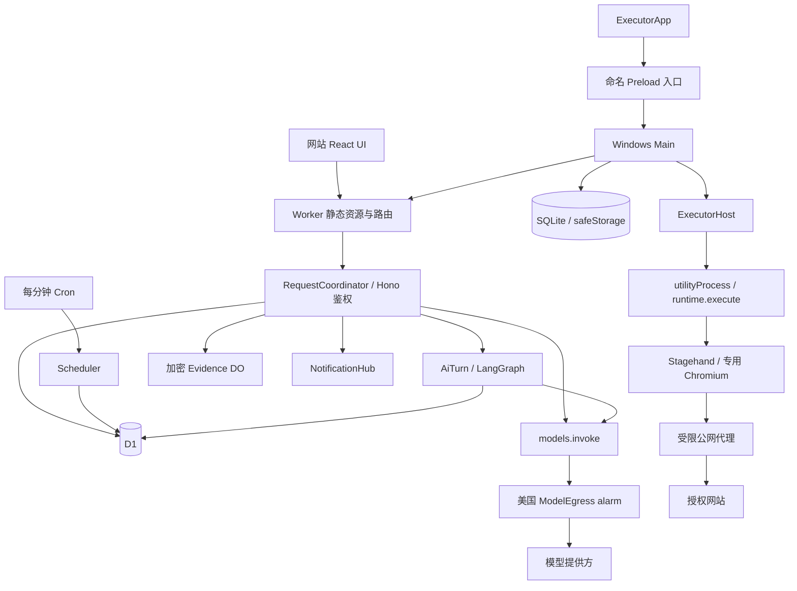
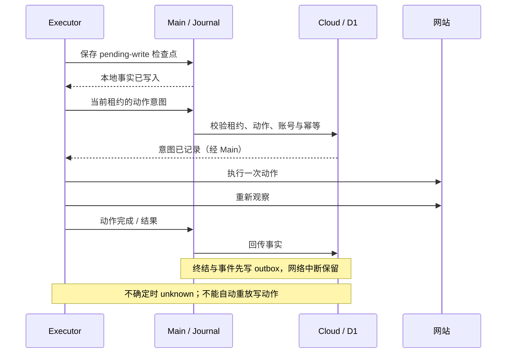
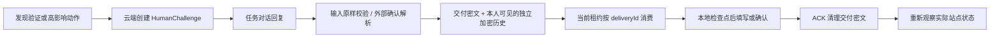
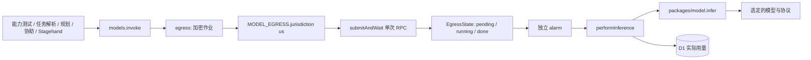

# TaskRelay 架构现状与改进候选

## 0.11.0 原始聊天与原生工具调用（2026-11-05）

- 用户消息、补充与加密协助原文直接进入执行器和 Stagehand 上下文；删除输入用途分类、原文片段提取以及 target/value 拆分。云端求助仅返回解释、是否需用户回答和受保护账号引用；账号内容整体交给执行器使用。
- 执行器通过模型原生工具调用使用 act/observe/extract、导航、切换页面、等待和求助；删除 TaskRelay 动作计划 JSON。普通助手文字直接作为本次最终答复，云端保存转发，不再要求完成类型或独立成功审核。reported 表示已回复，不证明业务全部成功。
- 原始用户输入不被操作摘要覆盖，历史执行记录可压缩并保存游标，避免反复摘要同一历史。Stagehand 原生树与元素编号仍保持完整。历史摘要按实际编码后的消息大小分块（含提示和 JSON 转义），避免固定字符比例浪费英文页面结构的窗口；原始输入和当前页仅在最终请求占用预算。逐回合检查租约与停止，不在运行结束后继续整理。模型配置与供应商限制不变。
- 删除未接入新主链的动作分类策略、批量项目绑定/核验代码、认证表单识别和旧回复截取函数；仅保留旧数据展示所需结构。身份隔离、加密、公网访问、站点凭据校验、停止、租约及同次调用防重保留。
- 协议 14，执行器 0.11.0，无新增迁移，不清除或重放历史。安装、部署及真实模型结果分别见部署与验收记录。

## 0.10.0 Stagehand AI 执行（历史）（2026-11-05）

- 固定 Stagehand 4.3.0，协议 13。执行器使用原生 `page.snapshot`（含 iframe）及 `act / observe / extract`；高层 AI 表达自然语言目标，不再猜 CSS。移除自写控件采集的 180 项/24000 字符截断。SDK AI 调用通过 `ClientLLM → /runner/runs/:id/stagehand → generateStructured/invoke → ModelEgress`，不增加直连或付费 Browserbase 依赖。
- Stagehand 页面树、控件编号与 JSON Schema 原样转发，独立于聊天摘要；图片请求替换为脱敏快照并校验当前模型视觉能力。`cache:false` 保持现场规划；`selfHeal:false` 避免 SDK 在无法确认点击是否已送出时隐藏重放。定位失败仍由完整 AI 循环重新观察、纠错。
- 动作意图在 Stagehand 定位回调完成后、返回浏览器执行之前登记，停止定位推理不冒充已点击。一次 act 可包含 SDK 支持的动态下拉等内部操作，同一调用整体防重。工具返回后读取新快照；导航过渡期观察失败保留 pending 并继续只读观察，不能重放提交。
- 执行上下文使用消息游标增量读取，不再每轮全量传输；删除最近 24 项/每项 500 字的静默丢弃。必要摘要返回执行器作为下一轮记忆，覆盖过的历史不重复摘要。Stagehand 原生树不使用该摘要。
- 用户强制要求：当前任务 AI 可读取账号、密码与验证码，判断消息是输入、新指令还是问题；本人聊天可显示。待协助回复仍加密存储，普通数据库消息列使用占位。无输入模式按钮、无必须先指定输入框的门槛，协助回复不自动填入旧输入框。旧账号是 AI 可选择的候选，不自动复用；旧验证码不作为新一次的持久输入候选。
- 保留账号隔离、公网访问、设备与租约、停止、凭据所属站点、动作调用编号防重；不添加业务成功门槛。平台模型密钥和设备令牌不属于允许进入任务模型的登录信息。

验证与部署状态分别记录在 ACCEPTANCE 和 DEPLOYMENT，源码通过不等于真实网站通过。

## 0.9.0 聊天主线（2026-11-05）

本节取代下方历史版本的运行流程描述。明确交办经云端意图检查后直接交给执行器；执行器拥有完整 AI 工具循环，遇到问题先向云端求助，云端无法解决再在同一聊天询问用户。工具反馈、截图和执行器最终答复使用同一消息流；移除旧云端 plan、批量核验、挑战回复及独立报告生产入口。

迁移 0019 保留历史与连接配置，绑定运行/截图到原聊天，导入旧运行事件；图片由私有加密 Evidence 保存，长期保留至聊天删除。协议 12 只领取新版运行。个人次数限制不恢复。条件卡和定时暂不扩展。

已通过新主链生产接口集成：多项目处理、云端求助、原聊天私密回复、继续执行、图片与最终答复；模型使用隔离提供方响应，不能代替部署环境真实模型验收。当前源码验证、打包、部署及现场验收仍在进行，尚不宣称已安装或真实积分通过。

## 0.8.10 DNS 传输容错（2026-11-05）

微软现场复验中独立复现 HTTPS DNS 连接重置。执行器仅对固定 DNS 的 ECONNRESET、超时等传输错误重试一次，成功后仍校验所有地址并固定公网 IP。拒绝响应、无效答案、私网和证书错误不重试；CONNECT 建立后的密码、验证码和业务字节不重放。失败只返回公开分类，不透传上游正文。协议仍为 11，无云端迁移或接口变化。

## 0.8.9 AI 动作判断与运行报告（2026-11-05）

- 动作用途由规划模型结合用户授权和现场观察判断，不用按钮关键词识别高影响业务、不用 DOM 前置动作类型限制流程。`effect` 仅承接 AI 对 read/fill/submit/publish/high_impact 的判断与既有授权；保留真实工具种类和目标唯一性检查。所有非链接点击、填写仍先写本地检查点和云端意图，观察失败保留 unknown，模型标签不能清除未决写入。
- 批量进度与动作准入解耦。`batchItemId` 为可选报告关联，不要求动作先绑定 pending 项目，也不以项目已发生一次点击禁止后续步骤。实际提交以动作指纹防重；换描述、同目标选择器或跟踪参数不能重放。已观察的界面 read 操作可再次使用，迁移 0018 保留提交唯一索引和所有历史记录。
- DOM adapter 继续采集真实可见文本、排除输入值和隐藏内容。无稳定 id 的容器也能保存观察；这些句柄不是业务身份的证明，AI 可用 previousId 关联页面变化后的同一项目。completed 明确表示 AI 根据真实反馈判断本次完成；未知写入仍需只读核查。
- 报告独立读取绑定运行和当时要求，不加入增长的聊天、用户偏好或其他运行。保留权威终态、结果与错误；重复事件保留次数，大记录经持久化模型链分段压缩。原始记录保留，报告失败只重试总结。没有提高模型配置预算，没有新增模型出站旁路。
- 协议 11 拒绝旧执行器领取；本机版本 0.8.9。部署和现场验证事实见 DEPLOYMENT、ACCEPTANCE。

本文描述当前源码；部署、安装和现场验证状态分别见 [DEPLOYMENT](DEPLOYMENT.md) 与 [ACCEPTANCE](ACCEPTANCE.md)。历史实现可从 Git 追溯，不再与当前拓扑并列。

## 2026-11-04 对话执行与运行条件（0.8.3）

- 协议 10，D1 增量迁移至 `0017_authentication_effects.sql`；本地 schema/historyEpoch 仍为 3，数据和连接配置保留。旧客户端不能领取新版运行。

### 等待诊断与快照（0.8.5）

每轮观察提供本轮耗时、剩余时间、页面未变化时长、连续等待次数、前次脱敏结构化快照，以及加载状态、资源错误和受限代理连接失败。AI 决定继续等待、重新规划、请求协助或 `blocked` 收尾；无固定等待次数或业务文字/图片硬比对。资源时序并不覆盖所有失败，不能将没有错误当成网络正常。

0.8.8 修复 CONNECT 隧道生命周期：60 秒空闲超时同步销毁网站端与浏览器端并记录 `TUNNEL_IDLE_TIMEOUT`；上游异常关闭记录 `TUNNEL_CLOSED`，连接错误记录固定分类，不保存错误正文。正常 FIN 由管道交付完整缓冲响应后结束。代理不重连或重放原请求；已提交动作继续遵守先观察和未知结果保护。DNS 完成后及连接建立时检查浏览器端是否已经关闭，避免为已退出客户端遗留连接。

关键动作前后、首次等待、页面变化及终止时保存遮蔽后的 PNG。输入控件、已知凭据文本和邮箱在截图时覆盖；媒体/iframe 临时隐藏，避免整页背景图的遮罩盖住正文。finally 移除覆盖层并恢复原样式，不改字段值。图片上限 1.5 MB，通过当前租约上传至私有加密 Evidence DO，最多保留 10 分钟，读取校验运行归属。截图失败仅记录不可用，不触发业务重试。模型使用前后结构化页面快照判断；PNG 用于用户核对，并不绕过模型 vision 能力配置。

认证动作/协助独立记录 authentication。尚未完成观察和 ACK 的认证写入仍保留未知结果保护；全部认证交互已观察且没有业务写入时，阻塞/超时可报告失败并释放账号。存在未决或业务写入仍进入 unknown；历史记录默认保守视为业务写入，不自动解锁。协议 10 阻止旧执行器应用新状态语义。
- 明确交办由 AI 结构化意图驱动，服务端验证归属、公网地址与版本后持久化 `conversation_commands`。恢复只重放幂等待办，不重复调用已经提交的模型回合或重复启动。
- `conversation_inbox` 持久化消息与 requestId/digest；一个线程串行处理模型回合，但随时接收下一条普通补充。创建、执行、协助和报告保持同一个 thread/task 关联，不存在前置确认卡。
- 当前要求存入运行快照及 `instruction_version`；长期要求单独存任务版本。待处理补充阻止新规划/动作；应用后拒绝旧版本动作和完成请求。已提交动作先观察，结果未知仍只读核查。敏感协助继续绑定挑战消费编号。
- 成功报告提炼 `run_conditions` 草稿，来源绑定运行、任务与指令版本。用户确认频率、模型、账号及条件后保存 approved_version/confirmed_content；定时运行读取确认内容作为经验，重新观察页面。失败或未知不生成成功条件，总结失败不改执行终态。
- 初次仅要求未来执行时只在对应时间启动一次；未经最终条件确认不继续周期触发。停止当前运行直接取消，暂停后续调度独立。修改业务目标后旧成功卡不能批准新版本；条件卡用户编辑内容代表新要求，不代表原运行验证过该内容。

### 保留的 AI 业务执行设计

- 增量迁移 0009 的业务执行记录继续保留，不清理历史、不更换密钥。
- 任务定义只提供 goal 与 batch：普通业务结果，或带范围、资格和排除项的逐项业务结果。删除 text_present/text_absent/url/extraction 精确条件及 verifyPage 执行路径。旧任务须重新确认；历史 unknown 的只读核查将原目标描述作为 goal 上下文，不恢复旧字面判断、不扩大写权限。
- AI 主导观察、规划、语义判断与纠错。inspect_batch 的 BatchPlan 只提交项目容器、可选历史关联 previousId、语义状态和理由、范围覆盖结论；不要求复制原文、证据 selector 或总数。程序自行采集可见页面/项目文本并保存来源和时间，AI 解释与实际页面内容分开存储。
- 完成不依赖文字相等/包含、URL 相等、固定数量、名称相等或页面变化。截断、页面加载状态属于观察上下文，不自动判为业务失败。普通 goal 必须有实际结果项目；批量记录保留已发现项目和未核实状态，不以排除冒充完成。
- 固定 DOM adapter 排除隐藏文本和输入值，不开放模型脚本。操作定位、公开地址和项目归属仍由程序检查；写入项目使用自身唯一 id/data-id 或唯一详情链接，不用 DOM 位置猜测跨观察业务身份。找不到可区分对象时继续只读寻找依据，不能猜测写入。
- 操作后的新观察只表示页面已重新读取，不等于业务成功；随后由 AI 判断。提交意图、检查点先于执行；写入传输中断或结果丢失保持 unknown 和账号锁，禁止重放。已尝试最终提交的项目不能通过重标 pending/excluded 再次写入或掩盖未决结果。
- 历史实现曾要求非认证写入绑定 pending 项目；0.8.9 已解除该限制。实际提交不因表单内容改变而重新解锁。共享 actionDigest 规范化字段顺序；确认仍绑定具体动作、步骤、租约与消费编号。
- 进度在 contracts/batch 与 cloud/batch 集中管理，真实 DOM 平台知识留在 executor adapter。进度按 run/lease AAD 加密，revision、写入代次和 CAS 守卫保存与最终状态。没有新增平行旧版本执行链。
- 规划提示解释已保存进度与 finish 的关系，由 AI 选择结束；连续相同工具反馈压缩为原文和出现次数，保留先后顺序及中间动作/错误。报告将运行 result 作为 JSON 对象传递，逐项证据不重复嵌入；保留最近核验事件、动作/错误及省略中间核验数量，完整事件仍在运行详情中。
- 规划 DOM 记录使用带 columns 的 rows 表格，省去重复字段名，保留实际文本、定位属性和 false 值；不截掉授权或用缩减上下文替代业务判断。
- 原文保留与输入值读回仅用于凭据/验证码准确填写，不作为业务成功条件。美国 ModelEgress、Free 平台、授权确认、并发、进程隔离及人工协助保护不变。模型判断不是任意网页结果的形式化证明。
- 个人每日启动、模型请求、对话次数可由管理员按账号暂停；手动开关优先于可选截止时间，原限额和用量不修改。领取选择与数据库触发器、模型/对话预占和 UI 共同使用该状态；账号隔离与安全保护不随之暂停；项目级全站预算已移除。

## 2026-11-04 人工协助后的规划状态

- 执行器页面观察只增加输入控件 `filled` 布尔值，不发送输入值或长度。人工输入完成后，后续规划历史明确记录协助类型、目标及已读回一致，不用泛化的“已处理”掩盖具体步骤；这不代表站点验证或任务已成功。
- 云端规划读取本次运行、当前 `leaseEpoch` 下已消费且有 deliveryId 的 code/information 目标摘要，最多 40 条；不读取 secret 或协助 instruction。未消费、过期、其他运行及旧租约协助不能成为已完成事实。已填信息不等于批准提交，具体动作仍经原批准绑定与程序核验。
- 该改动针对现场重复索取同一信息的问题，不改变授权、重放规则或模型出站链。源码与真实复验范围见验收台账。

## 2026-11-04 执行器版本更新

- Main 的 `loginSettings` 统一读取、迁移与修改登录启动项。读取 Electron 针对稳定启动器返回的 `launchItems`，仅接受本用户、固定 AppUserModelId、无额外参数且 enabled 的条目；不依赖 `openAtLogin` 对注册命令的大小写敏感比较，也不把系统已禁用的条目展示为开启。旧入口迁移保留启用偏好，已有稳定条目优先，默认不新增启动项。
- Main `DesktopUpdater` 管理版本元数据、确认后的下载、哈希校验、等待与本地 Squirrel 安装。Renderer 只展示 `DesktopUpdateStatus`，Preload 只增加命名检查/下载入口；Main 原生确认框绑定当前版本，模型和任务网页不能触发更新或指定下载地址。
- 所有更新网络固定经过 CF 的 `/api/updates/windows-x64`。Worker 在进入业务 DO 前路由公开发布元数据和固定资产的流式代理；无数据库变更、R2 或模型请求。发布目录保留版本、大小及 SHA-256/SHA-1，客户端拒绝降级、预发行/不合法版本、重定向和校验失败。源文件在 CF 代理内限定到本仓库 Release 及 GitHub 资产域名；普通用户输入不能改变源地址。
- Main 下载校验后才给 Squirrel 一个应用自有本地 feed；因此 Squirrel 不读取远程 RELEASES、不直连 GitHub，也不会在活动任务期间提前解包/应用更新。安装只在同步门闩关闭新领取后启动。`RunnerPoller` 持久化领取 requestId，丢失响应须按原编号解决；等待中的 connect/flush 返回后重新检查更新门闩。
- 空闲条件是无在途/未决领取、Host 无 current/child/stopPromise/stopping/未结束 RPC、本地 journal 无未完成记录且 outbox 已清空。Host `idleForUpdate` 等待已有 RPC 完成，不能只看 activeRunId。安装重启不调用 host.stop；下载和人工等待均不打断原运行。下载失败释放更新门闩，保留用户暂停偏好；unknown 云端锁不因更新而改变。
- 协议与 SQLite schema 保持 3；旧版首次启用需要手动安装。发布准备脚本与流程见 DEPLOYMENT，实际验证/发布状态见 ACCEPTANCE。

## 2026-11-04 可靠性修复：当前基线

当前产品为多用户网站与管理员设备池，网站使用应用会话鉴权，Windows Renderer 仅运行 ExecutorApp。协议和 SQLite schema 仍为 3；D1 新增兼容迁移 `0008_report_run.sql`。状态转移以生产实现及只读核查行为为准。

- ExecutorHost 的每个异步心跳返回后重验 child、generation 和停止状态。停止期间拒绝新 RPC；浏览器清理失败保留占用，阻止新执行并允许再次清理。Main 显式提供 Electron fork adapter，测试直接调用同一 Host implementation。
- OwnedBrowser 对整个启动过程持有代次与 pending promise；close 先使启动失效，再等待并清理。读取资源期间停止不再产生迟到浏览器。execute 在迟到凭据、人工消费检查点之后再次检查取消；未知消费保留不确定性。
- 重启恢复识别 finishing 中的 unknown；恢复与正常终结复用 `finish_<runId>` outbox 键，已排队终态不能被另一条恢复事实覆盖。恢复不重放浏览器写入。
- 报告请求必须包含 runId，并在接收时校验用户与任务归属，持久化到 ai_turns。alarm 从回合读取绑定，事实只读取该运行、该次任务快照与步骤；没有绑定的旧待执行报告明确失败，不默认为最新运行。
- 当前业务完成判断统一按上节的 AI 观察流程，不再保留精确单条件或词语/标点拦截。
- 快照仅显示个人用量与个人限额的启停状态。队列原因只解释当前已知阻塞条件，不能替代原子领取；本地暂停和实时网络仍可能影响可领取性。调度跳过超过迟到窗口的时隙，不生成过期排队记录。

验证与尚未完成的现场范围统一见 ACCEPTANCE 的 2026-11-04 批次。没有引入新的模型直连、调度器或通用主机工具。

## 2026-11-03 Cloudflare Free 运行架构

2026-11-04 协助补充：0.4.3 对 code/information/scan 强制非空目标，生产规划允许一次结构化修复；云端拒绝无目标挑战，执行器在请求协助前检查目标存在，避免消费回复后才发现缺少填写位置。批准点击由具体 high_impact 动作生成绑定摘要的批准请求。验证及用户暂停位置见 ACCEPTANCE 最新节。

继续使用 LangChain/LangGraph、D1 和原模型 API，不启用 Workers Paid、Queues、Workflows、Vectorize 或 LangSmith。协议与本地 schema 保持 3，D1 新增 `0007_free_runtime.sql`。

- `worker.ts` 仅处理静态资源、health 和路由；认证凭据的哈希选择 8 个 `RequestCoordinator` 分片，原始请求进入 DO 内的 Hono 完整鉴权。哈希不代表身份；不能缓存或共享权限结果。业务不再受普通 Worker 的 10 ms 请求 CPU 路径约束，仍受 DO 自身资源限制。
- 创建消息事务同时保存回合、用户消息和 `ai_dispatch` outbox，立即返回 202。每回合一个 `AiTurn` 对象，alarm 在 D1 原子领取后运行图；通知丢失由每分钟 Scheduler 补唤醒。领取后中断保持不确定，180 秒清理标为 unknown，不重放模型调用。终态通知客户端重新读取事实。
- `Scheduler` 的唯一原子范围是全局任务队列与维护；普通 HTTP 流量不集中到它。Cron 只唤醒 Scheduler，原租约、账号锁与调度规则仍在 D1。
- `NotificationHub` 使用 Hibernation WebSocket，仅推送 `changed`。连接由原认证路由建立，每次推送检查会话/设备有效性；订阅最多 8 条/对象，授权有效期 1 小时，下一次推送关闭过期连接并触发重新认证。网站隐藏时关闭订阅；快照与运行详情兜底 60 秒，活动 AI 回合 15 秒。客户端领取兜底从 4 秒变为 60 秒，运行中租约心跳仍为 15 秒。
- 证据每件独立 `Evidence` DO，最大 2 MB，500 KB 分块 AES-GCM，AAD 绑定对象 key 与分块序号；最长 10 分钟，alarm、读取过期校验和原业务清理共同生效。生产没有 R2 绑定；旧桶保留且不再使用。测试专用 DEV adapter 保留原内存 R2 夹具，不是生产回退。
- `ModelEgress` 的美国 jurisdiction、alarm、单次 submitAndWait 和持久化后 ACK 保持不变；AI 回合 DO 与请求 DO 均不能直接调用模型提供方。
- Stagehand Schema 使用锁定 Zod 4.6.7 的 `fromJSONSchema` 转换与原始输出校验，兼容 SDK 的 2020-12 Schema；独立 registry 防止 schema ID 累积/碰撞。该 API 尚属上游实验接口，升级须复跑生产路由与 workerd 回归。不在 Workers 中动态编译 Ajv，也不丢弃校验后直接信任模型输出。官方语义见 [Zod JSON Schema](https://zod.dev/json-schema?id=zfromjsonschema)。
- 不设置项目级每日模型、AI 回合、证据数量、请求分片及全站模型上限。实际用量仍记录，保留个人限额开关与安全限制；Cloudflare 官方额度和模型服务方限制由其各自执行，不自动付费扩容。
- 保留期清理跳过已失效数据，避免每分钟重复改写墓碑和会话版本。已存在成员读取不再反复更新成员记录；设备 last_seen 至少间隔 60 秒写入。
- 0.4.1 执行代理通过固定 Cloudflare HTTPS DNS 获取 A/AAAA，拒绝任意非公网答案，连接固定在已校验 IP。避免本机 TUN fake-IP 被误当成目的地址；不放开私网、任意端口或证书校验。真实网站流程和剩余验证限制见 ACCEPTANCE。

删除测试：普通 Worker 不能承载本次图计算；移除 outbox 会使 202 后唤醒丢失无从恢复；移除 ModelEgress 会丢失已验证的地区出站边界。因此这三类 adapter 分别承担运行时、可靠性和地区知识，不能让调用方复制其实现。

## 2026-11-03 LangChain / LangGraph：当前实现

0.3.0 引入协议 3、SQLite schema 3、D1 迁移 `0006_ai.sql`，生产历史切换已执行。其 CPU 阻断及后续免费架构解决情况见上节与验收台账。

- `apps/cloud/src/ai/graph.ts` 编排 compose、chat、plan、report，以及滚动 summary。状态只保存结构化结果；原始输入的 digest 防止相同 graph ID 被替换。检查点可恢复已完成图，结果不确定的模型调用保持 unknown，不自动重发。浏览器动作仍由独立 Executor 执行，图没有 Shell、JavaScript、文件工具或浏览器写操作。
- `RelayChatModel` 是 LangChain BaseChatModel adapter，结构化生成复用 `models.generateStructured`。生产链路仍为 `invoke → egress → 美国 ModelEgress alarm`；Chat Completions 和 Responses 均保留。关闭框架隐式重试；仅已收到但校验不通过的输出允许一次格式修复。调用 ID、输入 digest、额度预留和加密结果落在 D1，收到结果先保存再 ACK。
- `D1Checkpointer` 实现 LangGraph saver 的 checkpoint、parent、namespace、metadata、pending writes 和排序；`D1MemoryStore` 实现按用户隔离的 LangGraph store。检查点、pending writes、记忆和模型结果加密。使用 LangGraph 自带序列化器保留消息类型。删除/变更记忆通过事务失效旧图，迟到写入受 SQL 条件约束。
- CPU 优化后的图版本为 `relay-2`：合并空检查/验证节点，模型调用前后仍执行 guard，结构化输出及恢复结果仍校验，检查点保持同步持久化。typed serializer 字节采用 Base64 字符串保存，读取兼容原数字数组；AES-GCM、AAD 和密钥不变。回退版本必须支持此编码，不可直接回退到只支持数字数组的实现。
- Better Auth 按 D1 绑定和认证/邮件配置复用实例，不缓存用户会话，角色与撤销仍查询数据库。Zod Schema 仅缓存静态 JSON Schema；只需模型配置的路径不解密 API Key。历史裁剪一次计算各条消息字节，保留原预算规则。性能脚本仅启动隔离的本机 workerd，使用合成模型响应，不接生产数据或出站链路。
- `ai_threads/ai_turns/ai_messages` 是会话与消息事实源，独立于 LangGraph 检查点。创建草稿、缺失项、原始用户消息、滚动摘要均持久化；历史每页 50 条，按 seq 游标翻页，无固定 200 条截断。不设置站点名单，AI 从用户意图选择公开入口；网页内容不能增加业务授权。
- 每条消息携带 `requestId`；服务端收件箱串行处理，同线程一个 active turn，不阻止接收后续消息。消息去重、指令版本与条件确认版本分别校验。任务快照固定模型版本，跨用户归属由服务端认证决定，不接受模型提供 owner。
- 长期记忆仅允许用户在“我的记忆”明确确认后写入，最多 100 条。上下文最多读取最近 30 条偏好；不提供语义搜索，不接 Vectorize/embedding。LangSmith 云追踪和 verbose 环境开关会阻止 AI 调用，不会静默上传。
- 默认对话整理预算 16000、输出预留 4096，可在模型配置调整；对话历史仍按保守 UTF-8 字节估算分段摘要，原始消息继续分页可读，单条对话无法容纳时明确失败，不静默裁掉授权约束。结构化模型入口不把页面字节数当作 token 数作硬拒绝：规划调用方精简重复结构，提供方判断实际 tokenizer 与容量。回合上限 180 秒，未确认结果不重放。
- 聊天/报告读取已校验归属的任务、最近运行和脱敏事件。报告是解释文本，不能修改真实运行状态；协助进行中普通聊天被拒绝，验证码仍走独立加密回复通道。
- 已确认完成的 compose 与已删除会话分开标记。保留期清除正文和派生结果，留下无正文的请求 digest 墓碑防止过期请求重新执行。显式偏好不随会话保留期自动删除，可由用户单独删除。

旧 `/tasks/compose`、`/tasks/draft`、`/tasks/:id/chat` 已移除。新入口为 `/threads`、`/threads/:id/messages`、`/threads/:id/draft`、`/memories`。客户端通过 `x-taskrelay-protocol: 3` 与设备记录共同校验版本；升级沿用原 bearer token，旧协议不得继续领取或上传。

## 1. 运行拓扑与职责

| 位置 | 当前责任与关键入口 |
| --- | --- |
| `apps/web` / `packages/ui` | 网站 Transport、任务/对话/结果/设置；独立 ExecutorApp 只展示设备状态和执行控制 |
| `packages/contracts` | Zod 协议、限额、动作策略、成功判据、调度和公共地址检查 |
| `worker.ts` / `request-coordinator.ts` / `index.ts` | 静态与更新路由、请求分片、业务鉴权与路由；Scheduler 管理队列与维护 |
| `user.ts` / `admin.ts` / `pairing.ts` | 用户归属、管理员控制、任务确认、取消、只读核查和配对 |
| `runner.ts` / `store.ts` | 领取、租约、动作意图、协助消费、终结及账号锁 |
| `ai/` | 异步回合、图、检查点、摘要与明确确认的用户记忆 |
| `models.ts` / `egress*.ts` / `model-egress.ts` | 能力探测、结构化生成、实际用量及唯一美国后台出站 |
| `packages/model` | Chat Completions / Responses 转换、Schema 投影、用量和错误分类 |
| `apps/desktop/src/main` | 生命周期、令牌、SQLite、浏览器、Host 与空闲更新；UI 重载不重启执行 |
| `preload` / `shared/ipc.ts` | 命名执行器入口；Main 校验来源和参数，无通用用户管理请求 |
| `executor` | 独立进程中的任务循环、Stagehand、网络代理与证据；通过 Main 中转云端请求 |
| `scripts` / `forge.config.mts` | 资源准备、哈希验证、运行依赖暂存、打包、smoke 和发布清单 |

网站使用 Better Auth 会话与已验证邮箱。设备 bearer token 只访问设备和租约绑定入口；`/api/device/user/*` 固定拒绝。Access 只作为可选外层限制。管理员运维列表不返回其他用户的任务、对话、凭据或结果正文。

云端同时守卫设备并发 1、用户并发 1（含人工等待），按最久未领取用户、再按队列时间分配。账号首次领取绑定设备；迁移要求旧执行停止且无活动/unknown 运行或账号锁，创建新浏览器环境并重新登录。无账号任务用独立任务环境；共享设备必须可信，Profile 不对设备管理员保密。

上海日默认额度为启动 5、启用周期任务 3、排队 5、对话请求 50、模型请求 200/用户；个人每日次数限制可持续关闭，不设置全站每日额度。启动在领取时计数，模型出站前预占，重试不重复扣启动额度，未知调用不重放。

## 2. 领域与协议

| 术语 | 当前含义 |
| --- | --- |
| `TaskDefinition` | 可编辑任务的版本化定义，包含网站、账号、允许操作、成功判据、时间规则、`modelId` 和 `modelVersion` |
| `TaskRun` | 某次执行，保存任务快照、状态、截止时间、设备、租约、写入事实、结果，以及可选 `reconciliationOf` |
| `HumanChallenge` | 一次需要用户协助的步骤；类型为 code / scan / approval / information / unsupported，绑定运行、步骤、版本与租约 |
| `RunEvent` | 带唯一编号、运行编号、序号、时间和脱敏内容的事件；不是保存任意页面内容的日志 |
| `ModelProfile` | 版本化的提供方地址、协议、任意模型名、价格和能力结果；返回 `hasKey`，不返回 API Key |
| `SiteAccount` | 网站账号引用；云端保存加密凭据，本机使用隔离 Profile |
| `leaseEpoch` | 云端执行租约的代次，用于拒绝过期设备回传 |
| `generation` | 本机 child 代次，用于隔离旧 utilityProcess 消息；与租约是不同机制 |
| `writePending` / `mayHaveWritten` | 当前未核实的写入意图 / 本次执行曾可能产生写入；后者不会因单个动作完成就清除 |
| `reconciliationOf` | 新的只读运行与原 `unknown` 运行的关联，不是重新执行原写操作 |

实际协议常量为 `PROTOCOL_VERSION = 3`。配对、领取等入口检查版本，设备类型使用 `protocolVersion`；并非每个对象都含 `protocol_version`。`RunEvent` 本身不含 generation/epoch，epoch 位于上传请求，generation 位于本机 IPC。

时间规则的底层表示只有 `manual`、`once`、`cron`；每日/每周由创建对话转换成 cron，确认卡展示可读时间并允许详细编辑。默认时区为 `Asia/Shanghai`。共享限额为自动执行 5 分钟/40 动作、协助等待 5 分钟、心跳 15 秒、租约 90 秒、迟到 1 小时；自动执行计时扣除人工等待。全机并发 1 由云端领取及 Main/Host 守卫实现。

### 对话与运行条件

网站 AI 交互规则见 [AGENTS.md](../AGENTS.md#ui-专项要求)，实际检查见 [UI-REVIEW](UI-REVIEW.md)。共享组合位于 `packages/ui`，网站用 `App`，Windows 用独立 `ExecutorApp`；共享主题不意味着桌面拥有任务编辑和聊天入口。

`task-compose.tsx` / `use-thread.ts` 经 `/threads`、`/threads/:id/messages` 持久化交办和补充；首次创建任务后切换展示同一个线程。`run-conditions.tsx` 仅在成功后展示可编辑条件、频率、模型及账号，确认调用 `/tasks/:id/conditions`。不再使用草稿保存、创建确认、普通任务更新等旧业务入口。

`conversation.tsx` 处理历史、当前回合和绑定协助；`run-report.tsx` 展示真实事件与选中运行的报告。敏感回复不回显，过期或绑定切换清空输入；离线、已回复、过期或不支持的挑战不能提交。批准提交显式确认及原绑定，拒绝取消整次运行；扫码完成仍要求实际网站复核。请求代次防止旧查询覆盖新状态。

## 3. 任务执行与事实顺序

1. 用户明确交办，云端校验模型能力、网站与授权后创建首次运行；咨询仅回答。成功后自动生成条件草稿，用户最终确认执行频率、模型及账号后才开启重复调度。
2. Cron 扫描到期任务。幂等键避免重复排队，迟到窗口只补最近一次；存在未结束或 `unknown` 运行时不继续安排同任务的周期运行。
3. 桌面主动领取。D1 batch 将运行租约、设备领取记录和账号锁协调写入；同一领取请求可幂等返回，设备忙碌或账号被锁时不分配。
4. Main 保存 claimed 检查点，创建带 generation 的 utilityProcess，启动专用浏览器并载入账号 Profile。
5. Executor 观察页面，将脱敏观察提交云端规划。模型提出单个动作，程序根据授权、目标事实和页面状态校验；高影响动作进入协助流程。
6. 对有副作用的动作，先写本地检查点，再向云端保存动作意图，随后操作页面。重新观察后标记动作完成，不因观察失败而再次点击。
7. 满足成功判据才提交结果；事件和终结事实先进入本地 outbox，上传确认后删除。Main 重连时先冲刷 outbox，再领取新任务。
8. 心跳、取消、进程异常或恢复都保留不确定性。有可能写入且无法证明结果时以 `unknown` 终结并保留账号锁；无副作用的不完整运行可失败结束。

Stagehand 负责浏览器连接、观察/提取能力及统一模型回调；任务循环由 `runtime.execute` 自行控制，并未把整段任务交给 `Stagehand.agent`。navigate/click/fill 等实际动作使用页面方法，extract 使用 Stagehand 返回的数据。模型没有任意代码、Shell 或文件访问工具。

`store.finish`、租约超时和动作意图共同维护写入不确定性。只读核查领取时转移原账号锁；成功可将原 `unknown` 标记 `succeeded/already_done`，未核实则把锁还给原运行。

无调用且与只读核查冲突的旧 `assertTransition` 状态表已删除。实际转移仍由 store/runner/user 的事务条件共同守卫，尚未集中为单一状态机。

## 4. 所有人工协助共用对话通道

0016 为普通消息提供 private_content：用户可将误发内容设为仅本人可见。会话读取经归属校验后解密，模型读取 content 占位文本；同时撤销该会话摘要和派生检查点、清理对应 inbox 原文。该操作不能撤回已完成的提供方请求。

状态为 `pending → answered → consuming → consumed`，超时或运行结束进入 `expired` 并清理。创建、回复、消费、确认分别校验 live run、步骤、版本、租约和有效期；重复交付必须匹配同一个 deliveryId，不能换一次编号重复填写。

code/information 回复不调用模型，整条原样填写，保留前导零、大小写和字符；每次回复对应当前一个字段，多行输入明确拒绝。0015 的 assistance_replies 保存独立 AAD 加密历史，只有归属校验后的会话接口可解密显示，模型上下文/摘要/规划不查询它。按独立游标分页，清空会话及保留期清理密文。相同绑定、相同内容重发只返回已接收，不重复交付；不同内容拒绝覆盖。唯一输入框默认回复当前步骤，通过用途选择可发送普通补充，切换用途清空原值，防止密码误送模型。扫码图片短期放加密 Evidence DO；“已扫码”或“已确认”只允许继续核查，不代表站点已经通过。`unsupported` 明确终止该协助路径，不提供远程桌面或本地浏览器接管。

approval 还绑定具体操作摘要与目标事实，防止用户确认后页面变化导致批准另一项动作。Cloud 拥有协助与敏感内容生命周期，Executor 拥有填写及站点观察；这条 seam 需要保留。

## 5. 模型协议与美国区域出站

所有生产模型 HTTP 请求在这条后台链路末端发起。普通 Worker 的访客请求上下文不传给模型提供方；不能以普通 HTTP 转发或 placement hint 代替当前 alarm 出站。当前固定的是美国 jurisdiction，不固定某一个 colo，也不构成提供方永远接受请求的保证。

`EgressState` 在发请求前持久化 running；中断恢复后返回 `MODEL_CALL_OUTCOME_UNKNOWN`，不再次调用提供方。请求和分块结果使用 `MASTER_KEY` 与上下文加密，ACK 后删除，超时作业清理。测试通过存储 adapter 验证状态，不用于证明实际地区。

提交与等待使用一次 `submitAndWait` RPC；90 秒等待期限与内部唤醒由 `EgressState` 拥有。alarm 期间没有新的外部查询 RPC，返回终态后才 ack。这样避免 DO 共享 I/O 上下文被新进入的访客等待请求替换；原来的 `submit → RPC wait` 在新域名实际触发地区拒绝，修复后新旧域名和网页真实推理通过。`ModelEgress` 继续作为平台 adapter，不增加并行的出站通道。诊断 trace 与真实推理必须分别验收。

模型名不限制 GPT，默认 Chat Completions，可选 Responses。连接、工具调用、结构化输出是必需能力，图像输入独立测试。支持 JSON Schema 时使用严格输出；仅 JSON 模式时本地校验；格式修复预算最多一次。用量来自响应，没有 token 或价格时显示未知。

结构化输出已统一到 `models.generateStructured`：能力选择、JSON 解析、本地校验及一次修复预算由同一 module 拥有。`generate` 是 Zod adapter；Stagehand 路由使用 `stagehandSchema` 的 Zod 校验调用同一 interface。两次调用保持能力所选模式及模型版本，传输/未知结果错误在校验 catch 外传播，不触发格式修复。每次调用仍经 invoke、美国 alarm、performInference 记录实际用量。

删除了 `packages/model` 中仅用于测试的 `structured`。`tests/structured-production.test.ts` 直接调用 Hono plan/Stagehand 路由，经过真实 egress 与 EgressState；仅替换平台存储和外部 HTTP，覆盖两种协议、两种输出能力、修复预算、版本固定、用量、地区不可用及错误不重放。这是生产路径的隔离测试，不是新的真实云端验收。

## 6. 存储、认证和设备生命周期

| 存储/位置 | 权威范围与保留事实 |
| --- | --- |
| D1 | 任务版本、运行快照、租约、账号锁、事件、挑战、设备、模型配置/用量和证据索引。密钥、账号凭据和敏感回复加密保存 |
| SQLite Durable Objects | 请求分片、Scheduler 唤醒、AI 回合、模型出站、短期加密证据及休眠通知；任务/租约事实仍在 D1 |
| 本地 SQLite | `config/cache/journal/outbox`；WAL、FULL、busy timeout，当前 schema version 3，拒绝读取未来版本作为可写库 |
| Windows safeStorage | Main 持有的设备令牌加密；Renderer 只读脱敏状态 |
| Chromium Profile | 按账号隔离的站点会话；不上传到云端或诊断包 |

完整 D1 结构以 `apps/cloud/migrations/` 的 SQL 迁移为准（目前 0001 至 0008）。`schema.ts` 仅保留实际查询使用的 tasks 声明，认证表另在 `auth-schema.ts`，`user.ts` 的部分读取实际使用 Drizzle；大部分状态修改使用直接 D1 SQL。不能宣称 ORM 已统一管理所有表或迁移。

网站通过 Better Auth 会话与已验证邮箱校验身份，服务端实施用户归属与管理员角色隔离。桌面打开系统浏览器完成配对，取回可吊销设备令牌；云端校验哈希、撤销状态和协议版本。公开的配对开始/轮询入口另有有效期、轮询凭据和数量限制，不等于公开设备访问。

Main 控制应用生命周期，关窗口隐藏至托盘，退出停止领取并清理自有进程。浏览器恢复清理检查可执行文件和 Profile 的命令行身份，不能仅凭旧 PID 杀进程。安装环境下原生资源路径使用 `realpathSync.native` 处理 MSIX 文件重定向。

Stagehand 固定 4.3.0，Executor 打包保持原生动态 import。Forge Squirrel 生成 Windows x64 安装包，Electron 内置运行时；浏览器/扩展在 ASAR 外，构建前验证清单与哈希。0.4.7 起实现确认下载与空闲更新；发布通道和真实升级验收状态见验收台账。

## 7. 验证与交付边界

测试数量、版本与现场证据统一见 [ACCEPTANCE](ACCEPTANCE.md)，不在架构文档重复维护阶段统计。D1 的 Node SQLite stand-in 不证明真实 D1 并发；EgressState 的隔离测试不证明实际地区；模型能力通过不等于浏览器任务闭环。

打包 smoke 使用 `executor/entry.ts` 的独立流程，不调用生产 `runtime.execute` 或 ExecutorHost。生产执行与恢复另有 `executor-runtime.test.ts` / `executor-host.test.ts` 的隔离故障 adapter；这些测试也不替代真实整机故障、安装和长期观察。

Windows 扩展加载由 Main 的 `extension.ts` 管理：正式启动与 smoke 都将 ASAR 外的 Stagehand 扩展逐文件读取，按文件名与 SHA-256 生成内容目录，写入应用拥有的 runtime-extensions，完整核对后再传给独立 Executor。缓存缺失时原子准备，已存在但内容被改动或出现额外文件时拒绝加载，符号链接不作为扩展文件接受。此 adapter 处理安装目录下 Chromium 将内容脚本加载为空的现场问题，不修改 SDK、Chromium 权限或模型/页面工具边界。原安装扩展的固定公钥仍用于 CDP origin 限制。

自检报告记录实际客户端版本、程序/资源/扩展路径与 ASAR 哈希；验收清单同时检查报告新鲜度、版本、构建 ASAR 和实际安装文件，安装目录来自报告，不按 LOCALAPPDATA 猜测。`sourceDirty` 标记生成清单时工作区是否含未提交改动，`sourceCommit` 仍只是当时 Git 基线，不能把未提交构建冒充干净 tag 构建。原始清单含本机路径，仅供本地验收。

## 8. 架构候选与保留决定

以下采用 codebase-design 的 module、interface、depth、seam、adapter、leverage 与 locality 术语。候选不代表授权重构；现有改动及测试不能被描述成整体收敛已经完成。

| 候选 | 当前事实与 deletion test | 状态及后续验证 |
| --- | --- | --- |
| 结构化模型输出 module | 修复预算、校验和错误传播已集中到 `generateStructured` interface；删除重复循环提高 locality，调用方复用产生 leverage | 已实施；保留唯一出站 seam 和生产路由测试 |
| 运行状态与账号锁 module | store/runner/user 共同修改状态和锁；删除 store 会使事务知识扩散到调用方，已有 depth 应保留 | Worth exploring；收拢规则前核对取消/超时/终结交错与只读核查锁转移，复用 D1/SQLite adapter |
| 执行器恢复 module | Host recover/retire 仍解释 runtime 检查点；删除 Journal 会扩散 SQLite implementation | unknown 恢复与 finish outbox 幂等已修复，故障 adapter 已使用；整体收敛仍为候选，保持进程 seam 和代次/租约守卫 |
| 人工协助生命周期 module | 映射/原文截取在 challenges，回复/消费/清理跨 user/runner/store；删除 exactReply 会重复原文校验 | Worth exploring；云端生命周期可改善 locality，页面填写保留在 Executor；验证解析时过期、消费后崩溃与批准目标变化 |

`packages/model/src/schema.ts` 仅投影提供方支持的严格输出语法，原始约束仍在 `generateStructured` 校验，不能把投影后的宽松 Schema 当作任务授权校验。

应保留的平台 adapter：Web Transport、命名 Preload、ModelEgress、RelayChatModel、D1Checkpointer、D1MemoryStore 和 Journal。删除它们会把宿主、地区、加密或持久化知识扩散到调用方；文件短不等于冗余。云端/本机、Main/utilityProcess、可信策略/不可信页面的 seam 继续承担安全与恢复责任。

## 2026-11-03 创建对话的无协议域名识别

`task-sites.ts` 仅从用户消息识别完整 HTTPS 地址或明确的 ASCII 域名；无协议域名补全 HTTPS，路径和查询保留。规范化地址仅作为上下文线索，原消息不改写；用户不提供链接时 AI 可根据目标和产品名选择公开入口。`publicUrl`、执行时 DNS 公网检查和凭据所属站点检查继续生效，不做模型输出与用户网址的 origin 集合比对。显式 HTTP/其他协议、邮箱、凭据、私网和非标准端口不通过这一识别入口。国际化域名可使用完整 HTTPS 地址。
